# 🧭 AutoSelect-Commander - Autonomous Prompt Execution Manifest

> **Suite:** AutoSelect-Commander / Keyboard Automation  
> **Target Environment:** Windows 10/11, Google Antigravity 2.0 IDE, Electron/CDP Shells  
> **Document Role:** Master Index & Autonomous Execution Manifest for AI Agents & Automated Test Harnesses  
> **Author:** Atul Verma (`aiprincekumar` / `aiprincekumar010100@gmail.com`)  
> **Standard:** Department 01 (Product Requirements) & Department 07 (Technical Documentation)  
> **Operating Boundary:** Self-contained within `prompts/` directory. Zero manual user intervention required.

---

## 🏛️ 1. Executive Pipeline Architecture

The **AutoSelect-Commander Keyboard Automation Suite** is engineered to detect, navigate to, and interactively answer pending `ask_question` (Grill-Me) questionnaires in Antigravity 2.0 sessions completely autonomously. 

The system operates across three decoupled, deterministic steps coordinated via Inter-Process Communication (IPC) using a structured JSON state envelope (`target_chat.json`):

```mermaid
flowchart TD
    subgraph MasterPipeline [AutoSelect-Commander 3-Step Autonomous Pipeline]
        A[Start Master Pipeline / run_all_steps.bat] --> S1[Step 1: Chat Identifier & Window Focus]
        
        subgraph Step1Details [step_1_chat_identifier_prompt.md]
            S1 --> S1_Scan[Scan ~/.gemini/antigravity/brain transcripts]
            S1_Scan --> S1_Priority[Prioritize transcript_full.jsonl over transcript.jsonl]
            S1_Priority --> S1_Detect{Pending ask_question found?}
            S1_Detect -- No --> S1_Exit10[Write status: NO_PENDING_CHATS & Exit Code 10]
            S1_Detect -- Yes --> S1_Parse[Extract Questions & Detect Recommended Options]
            S1_Parse --> S1_Focus[Win32 Focus Lock Bypass: Alt Pulse + AllowSetForegroundWindow]
            S1_Focus --> S1_State[Save target_chat.json Dept 06 Envelope]
        end

        S1_Exit10 --> PipeCancel[Master Pipeline cleanly aborts remaining steps with Code 0]

        S1_State --> S2[Step 2: GUI Chat Select & Input Pane Focus]

        subgraph Step2Details [step_2_chat_and_focus_prompt.md]
            S2 --> S2_Check{Status == NO_PENDING_CHATS?}
            S2_Check -- Yes --> S2_CleanExit[Log Notice & Exit Code 0]
            S2_Check -- No --> S2_CDP[Connect to Chrome DevTools Protocol port 9222]
            S2_CDP --> S2_DOM[Query DOM for conversation_id element]
            S2_DOM --> S2_Glide[Humanized Smooth Bezier Cursor Glide to Sidebar Item]
            S2_Glide --> S2_Click[Dispatch Precision Click: DOM + OS mouse_event]
            S2_Click --> S2_CtrlL[Dispatch Ctrl + L to focus Chat Input Pane]
            S2_CtrlL --> S2_Update[Update target_chat.json: SUCCESS_SELECTED]
        end

        S2_Update --> S3[Step 3: Keyboard Automation & Golden Enter Gate]

        subgraph Step3Details [step_3_select_the_recommendation_prompt.md]
            S3 --> S3_Check{Status == NO_PENDING_CHATS?}
            S3_Check -- Yes --> S3_CleanExit[Log Notice & Exit Code 0]
            S3_Check -- No --> S3_Ingest[Read Question Count N & Option Indices from State]
            S3_Ingest --> S3_Loop[Deterministic Multi-Question Keystroke Loop: Q1..QN]
            S3_Loop --> S3_Intermediate[Q1 to QN-1: Ctrl+L -> Shift+Tab -> Option -> NO ENTER]
            S3_Intermediate --> S3_Final[QN: Ctrl+L -> Shift+Tab -> Option -> PRESS ENTER]
            S3_Final --> S3_Confirm[Submit Complete Questionnaire Response]
        end

        S3_Confirm --> S_Done([Pipeline Execution Certified Complete])
    end
```



---

## 📁 2. Step Prompts Directory & Manifest

To allow external AI agents, harnesses, or developers to construct, maintain, or debug each step independently without cross-step coupling, exhaustive standalone prompt specifications are provided:

| Specification Document | Step | Purpose & Core Subsystems | Primary Standalone Runner |
| :--- | :--- | :--- | :--- |
| [`step_1_chat_identifier_prompt.md`](./step_1_chat_identifier_prompt.md) | **Step 1** | Transcript Reverse Scanning, JSON Truncation Protection (`transcript_full.jsonl`), Win32 Foreground Lock Bypass, Maximization Preservation, Dept 06 State IPC, and **Exit Code 10 Protocol**. | `step_1_chat_identifier\run_step1.bat` |
| [`step_2_chat_and_focus_prompt.md`](./step_2_chat_and_focus_prompt.md) | **Step 2** | Antigravity GUI Navigation, Chrome DevTools Protocol (CDP RFC 6455) WebSocket, Bezier Curve Mouse Glide, Precision Click, `Ctrl + L` Chat Pane Focus, and Coordinate Fallbacks. | `step_2_chat_and_focus\run_step2.bat` |
| [`step_3_select_the_recommendation_prompt.md`](./step_3_select_the_recommendation_prompt.md) | **Step 3** | Pure Native Win32 `SendInput` Hardware Keystroke Injection, Console Window Blacklist, Dynamic Multi-Question Progression Loop (Q1..QN), and **The Golden Enter Gate**. | `step_3_select_the_recommendation\run_step3.bat` |
| [`multi_question_automation_prompt.md`](./multi_question_automation_prompt.md) | **Reference** | Foundational architectural specification and algorithmic proof for multi-question quiz mode and radio button detection. | N/A (Reference) |

---

## 🔄 3. Inter-Process State File Protocol (`target_chat.json`)

All steps communicate via the root-level IPC state file [`target_chat.json`](../target_chat.json), structured strictly under the **Department 06 JSON Envelope Standard**:

### Envelope Schema
```json
{
  "success": true,
  "data": {
    "conversation_id": "e0645f63-cc82-41f8-8385-2538e9e8f6bf",
    "topic_summary": "Session Topic Summary...",
    "last_user_prompt": "Last prompt issued by user...",
    "selected_at": "2026-11-03T03:54:16.616345+00:00",
    "status": "READY_FOR_GUI_SELECTION",
    "questions_count": 4,
    "total_questions_count": 4,
    "is_multi_question": true,
    "questions": [
      {
        "question_index": 1,
        "question": "Question text...",
        "options": ["(Recommended) Option 1", "Option 2"],
        "is_multi_select": false,
        "recommended_option_index": 1,
        "recommended_option_text": "(Recommended) Option 1"
      }
    ],
    "selections": [
      {
        "question_index": 1,
        "question": "Question text...",
        "selected_option_index": 1,
        "selected_option_text": "(Recommended) Option 1",
        "is_multi_select": false,
        "total_options": 2,
        "is_recommended": true
      }
    ],
    "window_hwnd": 328752,
    "window_title": "Antigravity Active Window Title",
    "window_focused": true,
    "dry_run": false,
    "gui_chat_selected": true,
    "gui_selection_method": "cdp_dom_click",
    "gui_selected_at": "2026-11-03T03:54:19.936876+00:00"
  },
  "meta": {
    "timestamp": "2026-11-03T03:54:19.936876+00:00",
    "generator": "step2_gui_chat_select.py (Dept 06 Architecture)"
  }
}
```

---

## 🚦 4. Exit Code Governance & Pipeline Signal Flow

| Exit Code | Emitting Step | Meaning & Signal Flow | Runner Action |
| :---: | :---: | :--- | :--- |
| **`0`** | Step 1, 2, 3 | **SUCCESS:** Step completed its operation cleanly and successfully. | Proceed to next step in pipeline. |
| **`1`** | Step 1, 2, 3 | **FATAL ERROR:** Process crashed, dependency missing, or unhandled exception. | Halt pipeline immediately with failure status. |
| **`10`** | **Step 1 Only** | **NO_PENDING_CHATS:** Zero active unanswered `ask_question` sessions exist in brain transcripts. State written with `status: "NO_PENDING_CHATS"` and `cancelled_remaining_steps: true`. | **Clean Pipeline Cancel:** Master runner skips Steps 2 and 3 and terminates with code 0. |

---

## 🤖 5. Autonomous Agent Consumption Guidelines

When an external AI coding agent, harness (e.g. Antigravity, SWE-bench, Claude Code), or autonomous test runner is tasked with building, testing, or executing any step:
1. **Zero-Scan Constraint:** Do NOT scan arbitrary machine folders or execute recursive directory searches. Rely entirely on the pre-mapped paths and contracts specified in these prompt documents.
2. **Step Isolation:** Each prompt is completely self-contained. An agent can implement or refactor any single step without breaking the other two, provided the IPC schema in `target_chat.json` is preserved.
3. **Execution Verification:** After implementing or executing any step, verify execution using the dedicated step runner batch script (`run_step1.bat`, `run_step2.bat`, or `run_step3.bat`) or the end-to-end master runner (`run_all_steps.bat`).
