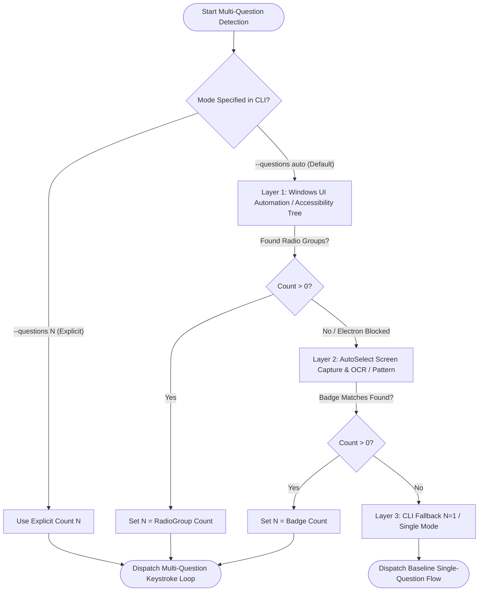

# Multi-Question Quiz Mode Automation: Architectural Specification & Implementation Prompt

> **Document Type:** Feature Specification & Phased Execution Blueprint  
> **Target Module:** `Keyboard Automation/` (Antigravity 2.0 Grill Me / Quiz Automation Suite)  
> **Primary Developer:** Atul Verma (`aiprincekumar` / `aiprincekumar010100@gmail.com`)  
> **Status:** APPROVED FOR IMPLEMENTATION (Single-Page Specification)  
> **Encoding Standard:** UTF-8 with BOM (`0xEF, 0xBB, 0xBF`)  

---

## 🎯 1. Executive Summary & Problem Scope

### 1.1 Context & Problem Statement
In Google Antigravity 2.0 (and related interactive agentic chat interfaces like Ask-Question / Grill-Me mode), questions are frequently presented in two distinct configurations:
1. **Single Question:** Exactly one question card with multiple choice options (Options 1, 2, ...).
2. **Multi-Question Quiz Card (Batch Questions):** Two or more interdependent questions grouped together in a single dialog card (e.g., Q1, Q2, ..., QN) that must all have choices selected before a single final submission is processed.

### 1.2 User Specification & Objective
- **Safety First:** The existing baseline single-question workflow (`execute()`) must remain **100% untouched and functional**.
- **Backup Isolation:** The `Keyboard Automation/archive/` folder serves exclusively as a permanent verified backup snapshot and must **never be modified or touched**.
- **Multi-Question Core Workflow:**
  When N questions are detected (N >= 2):
  - Every question follows an identical navigation and selection loop:
    1. Press `Ctrl + L` to focus/reset the chat input context.
    2. Settle pause (UI rendering & focus stabilization).
    3. Press `Shift + Tab` to step backward into the target option button group.
    4. Settle pause.
    5. Press `1` (or the configured option key for that question).
    6. Settle pause.
  - **The Golden Enter Gate:**
    - For questions 1, 2, ..., N-1: **Do NOT press Enter!**
    - Only on question N (the final question): **Press Enter** to submit the batch answer.

---

## 🔍 2. Question & Button Detection Strategies

To determine the question count N and option counts reliably without human intervention, three layered detection heuristics are defined in order of execution precedence:



### Strategy 1: Explicit Parameter & CLI Override (Precedence 1)
- Flags: `--questions N` or `-q N` (where N is an integer >= 1).
- Flags: `--options-list 1,1,1` or `-ol 1,1,1` allowing unique option selection per question (defaults to repeated option, e.g. `'1' * N`).
- If `--questions 1` is supplied, it gracefully routes to baseline `execute()`.

### Strategy 2: Windows UI Automation (UIA) Tree Inspection (Precedence 2)
- Utilizing `pywinauto` or native `UIAutomationCore.dll`:
  - Enumerate children of the focused Antigravity chat pane.
  - Search for `ControlType.Group` or elements with `LocalizedControlType = 'radio group'` / `Role = Radiogroup`.
  - Count distinct radio groups = N.

### Strategy 3: Visual & Screen Capture Pattern / OCR Heuristic (Precedence 3)
- Leverage existing `AutoSelect-Commander` screen capture and OCR pipeline:
  - Detect numbered question badges (e.g., regex `r'(?:Question|Q)\s*(\d+)[\s:]+'` or pattern `1 of 2`, `2 of 2`).
  - Detect multiple clusters of circular radio button glyphs.
  - Distinct badge coordinates determine count N.

---

## ⚡ 3. Deterministic Keystroke Loop Algorithm

Let N be the total number of questions, and O = [o_1, o_2, ..., o_N] be the sequence of option selections (default: all `'1'`).

```python
def execute_multi_question(self, total_questions: int, options: list[str]) -> bool:
    """
    Executes deterministic multi-question keyboard automation loop.
    Ensures Enter is strictly pressed ONLY on the final question.
    """
    logger.info(f"Initiating multi-question automation loop: {total_questions} questions")
    
    for q_idx in range(1, total_questions + 1):
        opt = options[q_idx - 1]
        is_last = (q_idx == total_questions)
        logger.info(f"--- Processing Question {q_idx}/{total_questions} [Select Option: '{opt}'] ---")
        
        # Step A: Focus chat input
        self._execute_step(f"Q{q_idx}.1", "Press [Ctrl + L] (Focus chat box)",
                           lambda: send_key_combo([VK_CONTROL, VK_L], hold_delay=self.hold_delay))
        time.sleep(self.step_delay)
        
        # Step B: Reverse tab to option buttons
        self._execute_step(f"Q{q_idx}.2", "Press [Shift + Tab] (Move backward to question options)",
                           lambda: send_key_combo([VK_SHIFT, VK_TAB], hold_delay=self.hold_delay))
        time.sleep(self.step_delay)
        
        # Step C: Select option key (e.g. '1')
        vk_opt = get_option_vk(opt)
        self._execute_step(f"Q{q_idx}.3", f"Press [{opt}] (Select Option {opt})",
                           lambda: send_single_key(vk_opt, hold_delay=self.hold_delay))
        time.sleep(self.step_delay)
        
        # Step D: Conditional Enter Gate
        if is_last:
            if not self.skip_enter:
                self._execute_step(f"Q{q_idx}.4", "Press [Enter] (Submit ALL answers on final question)",
                                   lambda: send_single_key(VK_RETURN, hold_delay=self.hold_delay))
            else:
                logger.info(f"Q{q_idx}.4: Skipping Enter on final question (user flag --skip-enter)")
        else:
            logger.info(f"Q{q_idx}.4: [SUPPRESS ENTER] Intermediate question {q_idx}/{total_questions} completed. Advancing...")
            time.sleep(self.step_delay)
            
    logger.info("[SUCCESS] Multi-question sequence finished successfully!")
    return True
```

### Detailed Timing Budget
| Phase | Action | Recommended Delay | Purpose |
| :--- | :--- | :--- | :--- |
| **Window Settle** | Restore & Maximize | `500ms` | Wait for Electron redraw |
| **Input Focus** | `Ctrl + L` | `250ms - 350ms` | Reset DOM focus to text field |
| **Reverse Tab** | `Shift + Tab` | `250ms - 350ms` | Shift focus into active radio group |
| **Option Press** | `Key '1'` | `150ms - 250ms` | Toggle radio check state |
| **Inter-Question**| Loop Advance | `350ms - 500ms` | Stabilize UI before next `Ctrl + L` |
| **Final Submit** | `Enter` | `500ms` | Submit batch response |

---

## 🧭 4. Tab-Order & Focus Traversal Analysis in Electron/Web DOM

### 4.1 Focus Reset Dynamics via `Ctrl + L`
In Antigravity 2.0 (VS Code / Electron architecture), `Ctrl + L` is a global accelerator bound to:
`workbench.action.chat.focusInput` or the chat input textarea.
Whenever `Ctrl + L` is triggered:
- Active focus is unconditionally pulled from any button, menu, or list into the `<textarea>` or `contenteditable` chat input box.
- This creates an immutable, known anchor point in the tab order.

### 4.2 Reverse Focus Traversal via `Shift + Tab`
When navigating backward (`Shift + Tab`) from the chat prompt textarea:
- In single-question cards, focus lands directly on the selected or first radio option of the active question card.
- In multi-question cards, successive `Shift + Tab` steps or repeated `Ctrl + L` resets allow deterministic access because `Ctrl + L` always grounds focus back at the input box, guaranteeing zero drift across iterations.

---

## 🏗️ 5. Architectural Integration Plan

### 5.1 Zero-Regression Principle
1. **Existing Method Intact:** `GrillMeAutomator.execute()` remains identical.
2. **New Dedicated Method:** Add `GrillMeAutomator.execute_multi_question(self, total_questions=2, options=None)` to `keyboard_automation/automator.py`.
3. **Dispatch Routing:** In `execute()`, if `self.questions > 1`, delegate to `execute_multi_question()`, or provide a unified dispatcher.

### 5.2 CLI Expansion (`keyboard_automation/cli.py`)
Add the following command-line flags:
- `-q`, `--questions`: Number of questions (default: `1`, supports integers or `'auto'`).
- `-ol`, `--options-list`: Comma-separated list of options (e.g., `1,2,1`). Defaults to option given by `-o` repeated for all questions.

### 5.3 Runner & Facade (`grill_me_automation.py`)
- Re-export `execute_multi_question` at package level.
- Ensure all batch files (`run_grill_me.bat`, `run_grill_me.ps1`) pass through arguments seamlessly.

---

## 🧪 6. Verification & Quality Gates

| Verification Layer | Test Target | Success Criteria |
| :--- | :--- | :--- |
| **Unit Testing** | Argument Parser (`cli.py`) | Flags `--questions 3 --options-list 1,2,1` parsed cleanly into list `['1', '2', '1']`. |
| **Simulation** | Dry-Run Engine | Running `--dry-run -q 3` logs 3 question passes, suppresses Enter on Q1 and Q2, and simulates Enter strictly on Q3. |
| **Safety Gate** | Browser Disqualification | Verified zero keystrokes sent if foreground window is Chrome/Edge/Firefox. |
| **Security Audit**| `gitleaks detect --redact` | 0 leaks detected. |
