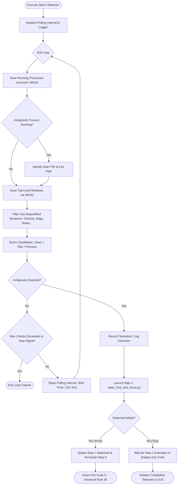

# Step 0: AntiGravity Detector - Autonomous Agent Implementation Prompt

> **Document Type:** Autonomous Agent Engineering Specification & Execution Blueprint  
> **Target Module:** `Keyboard Automation/step_0_antigravity_detector/`  
> **Hindi Name:** 'स्टेप 0 माइनस एंटी-ग्रेविटी डिटेक्टर'  
> **English Name:** 'Step 0 - AntiGravity Detector'  
> **Pipeline Step:** Step 0 of 3 (Pre-Pipeline Detection, Headless Polling & Automatic Trigger)  
> **Suite:** AutoSelect-Commander  
> **Primary Developer:** Atul Verma (`aiprincekumar` / `aiprincekumar010100@gmail.com`)  
> **Standard:** Department 06 (Backend & API Engineering) & Universal Rule 15/26  
> **Status:** APPROVED FOR PRODUCTION & TESTING EXECUTION  

---

## 🎯 1. Mission & System Directive

You are tasked with executing, maintaining, or extending **Step 0: AntiGravity Detector** ('स्टेप 0 माइनस एंटी-ग्रेविटी डिटेक्टर') of the AutoSelect-Commander automation pipeline.

### Core Directives
1. **Fully Automatic & Headless Background Operation:**
   - Execute silently in the background with no message boxes, no questions, and no GUI windows.
2. **Detection Condition:**
   - Detect whether Google Antigravity IDE is currently running or open via process enumeration (`Antigravity.exe` / `antigravity`) and Win32 top-level window hierarchy inspection (`Chrome_WidgetWin_1`).
3. **Browser Disqualification:**
   - Disqualify common web browsers (`chrome.exe`, `msedge.exe`, `firefox.exe`, `brave.exe`, etc.) so that browser tabs containing "Antigravity" in their title never trigger false positives.
4. **Automatic Pipeline Trigger:**
   - The instant Antigravity is detected, automatically launch the next script: **Step 1** (`step_1_chat_identifier/step1_find_and_focus.py`).
5. **Execution Hygiene (Universal Rule 26 - Zero Zombies):**
   - In production mode, spawn Step 1 as a detached background process and immediately exit Step 0 cleanly (Code 0), preventing lingering zombie processes or resource leaks.
6. **Two Standard Operating Runners:**
   - **Production Runner (`step0_antigravity_detector_prod.py` / `run_step0_prod.bat`):** 5-minute (300 seconds) polling cadence, silent background execution.
   - **Testing Runner (`step0_antigravity_detector_test.py` / `run_step0_test.bat`):** 10-second polling cadence with rich console telemetry for manual inspection and verification.

---

## 🔍 2. Architectural Blueprint & Operational Flow



---

## 📁 3. File Topology & Modules

| File | Role | Type |
| :--- | :--- | :--- |
| **`step_0_antigravity_detector/__init__.py`** | Package exports: `AntiGravityDetector`, `DetectionResult`, and interval constants. | **PACKAGE INIT** |
| **`step_0_antigravity_detector/antigravity_detector_core.py`** | Modular detector engine: process inspection, window enumeration, browser filter, and Step 1 launcher. | **CORE ENGINE** |
| **`step_0_antigravity_detector/step0_antigravity_detector_prod.py`** | Production runner: 5-minute polling interval, fully headless. | **PROD RUNNER** |
| **`step_0_antigravity_detector/step0_antigravity_detector_test.py`** | Testing runner: 10-second interval, rich visual telemetry, supports `--once`, `--no-launch`, `--json`. | **TEST RUNNER** |
| **`step_0_antigravity_detector/run_step0_prod.bat`** | 1-click batch launcher for Production runner with self-healing `.venv`. | **PROD BATCH** |
| **`step_0_antigravity_detector/run_step0_test.bat`** | 1-click batch launcher for Testing runner with live console logs. | **TEST BATCH** |
| **`step_0_antigravity_detector/test_step0_detector.py`** | Automated unit test suite verifying data structures, intervals, and detection logic. | **UNIT TEST** |

---

## 🛠️ 4. CLI Arguments Reference

### Testing Runner (`step0_antigravity_detector_test.py`)
```cmd
python step0_antigravity_detector_test.py [OPTIONS]

Options:
  --interval FLOAT    Polling interval in seconds (default: 10.0)
  --once              Perform single-shot detection check and exit
  --no-launch         Dry run: detect Antigravity without triggering Step 1
  --wait              Wait for Step 1 completion and report exit code (default: True)
  --no-wait           Spawn Step 1 detached and exit immediately
  --json              Output detection result in Department 06 JSON Envelope
  --max-checks INT    Stop after N failed checks (default: infinite)
```

### Production Runner (`step0_antigravity_detector_prod.py`)
```cmd
python step0_antigravity_detector_prod.py [OPTIONS]

Options:
  --interval FLOAT    Polling interval in seconds (default: 300.0 = 5 minutes)
  --interactive       Display visible telemetry instead of silent background operation
  --wait              Wait for Step 1 completion instead of detached spawn
  --log-file PATH     Path to persistent log file
```
