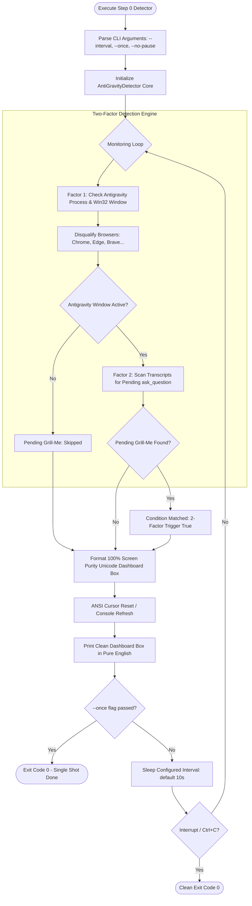

# Step 0: AntiGravity Detector - Autonomous Agent Implementation Prompt

> **Document Type:** Autonomous Agent Engineering Specification & Execution Blueprint  
> **Target Module:** `Keyboard Automation/step_0_antigravity_detector/`  
> **Hindi Name:** 'स्टेप 0: एंटी-ग्रेविटी डिटेक्टर'  
> **English Name:** 'Step 0: AntiGravity Detector & Two-Factor Status Monitor'  
> **Pipeline Step:** Step 0 of 9 (Condition Detection & Status Monitoring Subsystem)  
> **Suite:** AutoSelect-Commander  
> **Primary Developer:** Atul Verma (`aiprincekumar` / `aiprincekumar010100@gmail.com`)  
> **Standard:** Department 06 (Backend & API Engineering), Department 02 (Solution Architecture) & Department 01  
> **Status:** APPROVED FOR PRODUCTION & TESTING EXECUTION (19/19 Unit Tests Passed)  

---

## 🎯 1. Mission & System Directive

You are tasked with executing, maintaining, or extending **Step 0: AntiGravity Detector** ('स्टेप 0: एंटी-ग्रेविटी डिटेक्टर') of the AutoSelect-Commander automation pipeline.

### Core Directives & Architectural Separation of Concerns
1. **Decoupled Single Responsibility (Pure Status & Condition Detector):**
   - Step 0 serves exclusively as a **Status Monitor and Grill-Me Question Detector**.
   - **Crucial Architectural Rule:** Step 0 does **NOT** chain, trigger, or launch Step 1 or any subsequent steps. All pipeline chaining, settle delays, scheduling, and execution orchestration are owned exclusively by **Step 9: Complete Automation Hub** (`step_9_complete_automation/`).
2. **Two-Factor Trigger Condition:**
   - Both factors must evaluate to `True` for condition match:
     1. **Factor 1 - AntiGravity Open:** Google Antigravity 2.0 IDE is running and its main window (`Chrome_WidgetWin_1`) is present.
     2. **Factor 2 - Pending Grill-Me Question:** At least one unanswered `ask_question` tool call exists in the local transcript logs (`~/.gemini/antigravity/brain/`).
3. **Browser Disqualification:**
   - Disqualifies common web browsers (`chrome.exe`, `msedge.exe`, `firefox.exe`, `brave.exe`, `opera.exe`, etc.) to prevent false triggers from browser tabs titled "Antigravity".
4. **100% Screen Purity & Clean Unicode Dashboard Box:**
   - Console output is restricted strictly to a clean, border-aligned Unicode dashboard box in pure English.
   - Zero technical stdout spam, zero noisy trace logs, and zero flickering debug dumps.
   - Automatically refreshes the screen on every polling tick using ANSI cursor reset (`\033[H`).
5. **Unified Canonical Entrypoint:**
   - **Canonical Script:** `step0_antigravity_detector.py` (with configurable `--interval`, `--once`, `--no-pause`, `--json`).
   - **Canonical Batch Launcher:** `run_step0.bat` (1-click self-healing launcher).
   - **Backward-Compatibility Aliases:** `step0_antigravity_detector_test.py` and `run_step0_test.bat` forward cleanly to the canonical script.

---

## 🔍 2. Architectural Blueprint & Operational Flow



---

## 🖥️ 3. 100% Screen Purity Unicode Dashboard Box

Step 0 renders a clean, professional status box on every tick. The dashboard is pure English and provides instant visual verification:

```text
┌────────────────────────────────────────────────────────────────────────┐
│               ANTIGRAVITY STATUS & GRILL-ME MONITOR                    │
├────────────────────────────────────────────────────────────────────────┤
│  Timestamp        : 2026-11-04 05:25:00 UTC                            │
│  Antigravity IDE  : OPEN (PID: 28412, HWND: 0x00040E9A)                │
│  Grill-Me Status  : 1 PENDING QUESTION(S) WAITING                      │
│  Target Chat ID   : 6b52232f-0326-437c-9a22-cecab6452125               │
│  2-Factor Trigger : READY FOR AUTOMATION                               │
│  Next Poll In     : 10 seconds (Press Ctrl+C to terminate)             │
└────────────────────────────────────────────────────────────────────────┘
```

When Antigravity is not open or no question is pending:
```text
┌────────────────────────────────────────────────────────────────────────┐
│               ANTIGRAVITY STATUS & GRILL-ME MONITOR                    │
├────────────────────────────────────────────────────────────────────────┤
│  Timestamp        : 2026-11-04 05:25:00 UTC                            │
│  Antigravity IDE  : NOT DETECTED (Idle)                                │
│  Grill-Me Status  : NO PENDING QUESTIONS                               │
│  2-Factor Trigger : IDLE (Waiting for Antigravity & Questionnaire)     │
│  Next Poll In     : 10 seconds (Press Ctrl+C to terminate)             │
└────────────────────────────────────────────────────────────────────────┘
```

---

## 📁 4. File Topology & Modules

| File | Role | Type |
| :--- | :--- | :--- |
| **`step_0_antigravity_detector/__init__.py`** | Package exports: `AntiGravityDetector`, `DetectionResult`, and constants. | **PACKAGE INIT** |
| **`step_0_antigravity_detector/antigravity_detector_core.py`** | Modular detector engine: process inspection, window scoring, browser filter, brain scan. | **CORE ENGINE** |
| **`step_0_antigravity_detector/step0_antigravity_detector.py`** | **Canonical Unified Status Monitor:** Configurable polling interval, clean dashboard, `--once` mode. | **CANONICAL SCRIPT** |
| **`step_0_antigravity_detector/run_step0.bat`** | **1-Click Canonical Launcher:** Launches Step 0 with auto-detected `.venv` and clean terminal output. | **STEP RUNNER** |
| **`step_0_antigravity_detector/step0_antigravity_detector_test.py`** | Backward-compatibility alias forwarding directly to canonical script. | **ALIAS SCRIPT** |
| **`step_0_antigravity_detector/run_step0_test.bat`** | Backward-compatibility batch alias calling `run_step0.bat`. | **ALIAS RUNNER** |
| **`step_0_antigravity_detector/test_step0_detector.py`** | Automated unit test suite verifying data structures, intervals, detection logic, and alias parity (19/19 passed). | **UNIT TEST** |

---

## 🛠️ 5. CLI Arguments & API Reference

### Canonical Script (`step0_antigravity_detector.py`)
```cmd
python step0_antigravity_detector.py [OPTIONS]
```

| Argument | Type | Default | Description |
| :--- | :--- | :--- | :--- |
| `--interval`, `-i` | float | `10.0` | Polling loop interval in seconds. Set to `300.0` for 5-minute production monitoring. |
| `--once` | flag | `False` | Execute a single detection check, output status, and exit immediately with code `0`. |
| `--no-pause` | flag | `False` | Suppress the interactive "Press any key to exit..." prompt upon exit. |
| `--json` | flag | `False` | Output detection result in Department 06 JSON envelope format instead of dashboard box. |
| `--brain-dir` | path | `None` | Custom path to Antigravity brain transcripts folder. |

---

## 🔗 6. Integration Contract with Step 9 (Master Orchestrator)

Step 9 (`step_9_complete_automation/complete_automation.py`) imports the detector core directly:
```python
from step_0_antigravity_detector.antigravity_detector_core import (
    AntiGravityDetector,
    DetectionResult,
    get_antigravity_chat_stats,
    resolve_brain_dir,
)
```
- Step 9 instantiates `AntiGravityDetector(brain_dir=...)` and polls on its configured interval (`timing.step0_poll_interval_prod_seconds` or `timing.step0_poll_interval_test_seconds`).
- When `detector.detect()` reports `result.condition_matched == True`, Step 9 proceeds to execute Step 1 -> Step 2 -> Step 3 -> Step 4.
