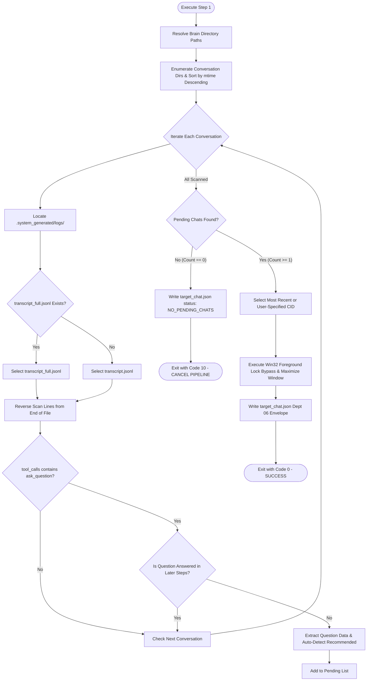

# Step 1: Chat Identifier & Window Focus - Autonomous Agent Implementation Prompt

> **Document Type:** Autonomous Agent Engineering Specification & Execution Blueprint  
> **Target Module:** `Keyboard Automation/step_1_chat_identifier/`  
> **Pipeline Step:** Step 1 of 3 (Transcript Scanning, State Persistence & Focus Subsystem)  
> **Suite:** AutoSelect-Commander  
> **Primary Developer:** Atul Verma (`aiprincekumar` / `aiprincekumar010100@gmail.com`)  
> **Standard:** Department 01 (Product Requirements) & Department 06 (Backend & API Engineering)  
> **Status:** APPROVED FOR AUTONOMOUS AGENT EXECUTION  

---

## 🎯 1. Mission & System Directive

You are tasked with implementing, verifying, or executing **Step 1: Chat Identifier & Window Focus** of the AutoSelect-Commander automation pipeline.

### Core Directive
The agent running this step must:
1. Scan the local Antigravity brain transcripts to locate active, unanswered `ask_question` (Grill-Me) conversations.
2. Prioritize `transcript_full.jsonl` to guarantee zero payload truncation even on large multi-question surveys ($N \ge 4$).
3. Extract question text, options list, and automatically detect recommended choices.
4. Execute Windows 10/11 Win32 foreground lock bypass to bring the Antigravity window to crisp focus, safely preserving or setting maximized state.
5. Persist the extracted state into `target_chat.json` adhering to the Department 06 JSON Envelope standard.
6. **Enforce the Exit Code 10 Protocol:** If no active, unanswered `ask_question` chat exists, write cancellation state and exit with process code `10`.

---

## 🔍 2. Architectural Blueprint & Operational Flow



---

## 🛠️ 3. Exhaustive Technical Specifications

### 3.1 Antigravity Brain Directory Discovery Protocol
The Antigravity brain directory stores per-conversation logs and transcripts. The agent must resolve the brain root using strict priority order without recursive scanning:

1. **CLI Explicit Override:** `--brain-dir <PATH>` if supplied.
2. **Environment Variable:** `os.environ.get("ANTIGRAVITY_BRAIN_DIR")`.
3. **Primary Standard Path:** `C:\Users\Atul Verma\.gemini\antigravity\brain` (expanded via `Path.home() / ".gemini" / "antigravity" / "brain"`).
4. **Fallback Candidate:** `~/.gemini/antigravity/brain`.

### 3.2 Transcript File Selection & Truncation Safeguard
Antigravity generates two transcript files in each conversation directory (`<conversation_id>/.system_generated/logs/`):
- `transcript.jsonl`: Compact representation. **WARNING:** Truncates fields exceeding byte thresholds into `truncated_fields: ["tool_calls"]` or `["content"]`.
- `transcript_full.jsonl`: Full, non-truncated record containing complete raw JSON arguments.

> [!IMPORTANT]
> Step 1 **MUST** check for and prioritize `transcript_full.jsonl`. When multi-question cards ($N = 4$ or more questions) are present, the `tool_calls` payload exceeds the compact byte limit. Reading only `transcript.jsonl` will fail to extract questions.

### 3.3 Reverse Line Scanning & Answer State Detection
1. Parse the JSONL file line-by-line into an ordered list of step dictionaries.
2. Scan backwards from the newest step (`total_steps - 1` down to `0`).
3. For each step, inspect `tool_calls`:
   ```python
   for tc in step.get("tool_calls", []):
       call_name = tc.get("name") or tc.get("tool_name") or ""
       if call_name == "ask_question":
           # Check if answered
   ```
4. **Answered Verification (`_is_step_answered`):**
   A question is answered if any subsequent line $j > i$ satisfies:
   - `subsequent.get("type") == "USER_INPUT"`
   - `subsequent.get("type") == "GENERIC"` containing text: `"Completed At:"`, `"A1:"`, or `"Answer"`
   - `subsequent.get("type") == "PLANNER_RESPONSE"` with `status == "DONE"` and no `ask_question` tool call.
   If none of these conditions are met, the question is **ACTIVE AND UNANSWERED**.

### 3.4 Question Payload Extraction & Unicode Resilience
Tool arguments for `ask_question` may arrive in diverse shapes:
1. **Multi-Question Schema:** `args["questions"] = [...]` (array of question objects).
2. **Stringified JSON:** `args["questions"]` is a stringified JSON string. Must parse with `json.loads(raw_questions, strict=False)`. If escapes are present, unescape using `raw_questions.encode("utf-8").decode("unicode_escape", errors="ignore")`.
3. **Single-Question Schema:** Direct keys `args["question"]` and `args["options"]`.
4. **Automatic Recommendation Detection:**
   For each question:
   - Iterate through `options` (1-indexed).
   - If an option starts with `(Recommended)` or contains `[Recommended]`, set `recommended_option_index = idx` and `recommended_option_text = opt`.
   - If no recommended flag exists, default to Option 1 (`index = 1`).

---

## 🪟 4. Win32 Foreground Lock Bypass & Window Management

Windows 10 and 11 prevent background applications from stealing foreground focus (`SetForegroundWindow` lock), causing windows to flash on the taskbar rather than activating.

Step 1 implements a 5-point Win32 bypass protocol using pure `ctypes.windll.user32`:

```python
# 1. Attach interactive input desktop
hdesk = user32.OpenInputDesktop(0, False, 0x0100) # DESKTOP_SWITCHDESKTOP
if hdesk:
    user32.SetThreadDesktop(hdesk)

# 2. Unlock foreground window permission
user32.AllowSetForegroundWindow(ASFW_ANY) # ASFW_ANY = -1

# 3. Pulse Alt key to break input lock
VK_MENU = 0x12
user32.keybd_event(VK_MENU, 0, 0, 0)
user32.keybd_event(VK_MENU, 0, 0x0002, 0) # KEYEVENTF_KEYUP

# 4. Attach thread input of foreground window to current thread
fore_hwnd = user32.GetForegroundWindow()
fore_tid = user32.GetWindowThreadProcessId(fore_hwnd, None)
cur_tid = kernel32.GetCurrentThreadId()
if fore_tid != cur_tid:
    user32.AttachThreadInput(cur_tid, fore_tid, True)

# 5. Restore or Maximize Window Safely
if user32.IsIconic(target_hwnd):
    user32.ShowWindow(target_hwnd, SW_RESTORE) # SW_RESTORE = 9
elif not user32.IsZoomed(target_hwnd):
    # If not already maximized, maximize for optimal viewing
    user32.ShowWindow(target_hwnd, SW_MAXIMIZE) # SW_MAXIMIZE = 3
else:
    # Already maximized: keep maximized!
    user32.ShowWindow(target_hwnd, SW_SHOW)

# 6. Bring to foreground and bump Z-order
user32.SetForegroundWindow(target_hwnd)
user32.BringWindowToTop(target_hwnd)
user32.SetWindowPos(target_hwnd, HWND_TOPMOST, 0, 0, 0, 0, SWP_NOMOVE | SWP_NOSIZE | SWP_SHOWWINDOW)
user32.SetWindowPos(target_hwnd, HWND_NOTOPMOST, 0, 0, 0, 0, SWP_NOMOVE | SWP_NOSIZE | SWP_SHOWWINDOW)

# Detach thread input
if fore_tid != cur_tid:
    user32.AttachThreadInput(cur_tid, fore_tid, False)
```

---

## 📦 5. State File IPC Specification (`target_chat.json`)

All state is written to `target_chat.json` (and synchronized with `last_selection_state.json`) formatted with UTF-8 encoding.

### Active Pending Chat Envelope
```json
{
  "success": true,
  "data": {
    "conversation_id": "e0645f63-cc82-41f8-8385-2538e9e8f6bf",
    "topic_summary": "Session summary...",
    "last_user_prompt": "Prompt text...",
    "selected_at": "2026-11-03T03:54:16.616345+00:00",
    "status": "READY_FOR_GUI_SELECTION",
    "questions_count": 4,
    "total_questions_count": 4,
    "is_multi_question": true,
    "questions": [
      {
        "question_index": 1,
        "question": "Question 1 text",
        "options": ["(Recommended) Choice A", "Choice B"],
        "is_multi_select": false,
        "recommended_option_index": 1,
        "recommended_option_text": "(Recommended) Choice A"
      }
    ],
    "selections": [
      {
        "question_index": 1,
        "question": "Question 1 text",
        "selected_option_index": 1,
        "selected_option_text": "(Recommended) Choice A",
        "is_multi_select": false,
        "total_options": 2,
        "is_recommended": true
      }
    ],
    "window_hwnd": 328752,
    "window_title": "Antigravity Active Window Title",
    "window_focused": true,
    "dry_run": false
  },
  "meta": {
    "timestamp": "2026-11-03T03:54:16.616345+00:00",
    "generator": "step1_find_and_focus.py (Dept 06 Architecture)"
  }
}
```

---

## 🚫 6. The Exit Code 10 Protocol (Clean Pipeline Cancellation)

When Step 1 executes and discovers **ZERO** conversations with active unanswered `ask_question` payloads:

1. **Write Cancellation State:**
   ```json
   {
     "success": true,
     "data": {
       "conversation_id": "",
       "topic_summary": "",
       "last_user_prompt": "",
       "status": "NO_PENDING_CHATS",
       "message": "No chat with pending Grill Me / ask_question found across transcripts.",
       "cancelled_remaining_steps": true,
       "questions_count": 0,
       "total_questions_count": 0,
       "is_multi_question": false,
       "questions": [],
       "selections": [],
       "window_hwnd": 0,
       "window_title": "",
       "window_focused": false,
       "dry_run": false
     },
     "meta": {
       "timestamp": "2026-11-03T03:54:16.616345+00:00",
       "generator": "step1_find_and_focus.py (Dept 06 Architecture)"
     }
   }
   ```
2. **Log Informational Banner:**
   ```
   ============================================================================
     [INFO] NO PENDING GRILL ME / ASK_QUESTION CHATS FOUND
     [*] All remaining steps [Step 2 and Step 3] cancelled automatically.
     [*] Automation script closing now.
   ============================================================================
   ```
3. **Exit Process with Code 10:**
   ```python
   sys.exit(10)
   ```
4. **Master Runner (`run_all_steps.bat`) Interception:**
   ```batch
   "%PYTHON_EXE%" "%STEP1_SCRIPT%" --state-file "%STATE_FILE%" %*
   set "STEP1_EXIT=%ERRORLEVEL%"
   if "%STEP1_EXIT%"=="10" (
       echo [INFO] NO PENDING CHATS. Remaining steps cancelled.
       goto :CLEAN_CLOSE
   )
   ```

---

## 💻 7. CLI Parameters & Standalone Runner

### Runner Location: `step_1_chat_identifier\run_step1.bat`
```cmd
cd "c:\Users\Atul Verma\Desktop\AutoSelect-Commander\Keyboard Automation\step_1_chat_identifier"
run_step1.bat
```

### CLI Flag Reference
| Flag | Type | Default | Description |
| :--- | :---: | :---: | :--- |
| `--state-file` | `str` | `"target_chat.json"` | Path to write the JSON state envelope. |
| `--cid` | `str` | `None` | Explicit conversation ID to target (bypasses auto-selection). |
| `--brain-dir` | `str` | `None` | Custom path to Antigravity brain transcripts. |
| `--dry-run` | `flag` | `False` | Simulates scanning and state writing without shifting OS window focus. |
| `--no-focus` | `flag` | `False` | Skips window foreground focus and state restoration. |
| `--no-pause` | `flag` | `False` | Suppresses interactive console pauses for automated pipelines. |

---

## 🧪 8. Acceptance Criteria (Given-When-Then)

### Scenario 1-A: Active Single-Question Grill-Me Detected
- **Given:** A conversation exists in `~/.gemini/antigravity/brain` with an unanswered `ask_question` tool call with 1 question.
- **When:** `step1_find_and_focus.py` is executed.
- **Then:** It extracts question and options, identifies `(Recommended)` option, maximizes and focuses Antigravity window, writes `status: "READY_FOR_GUI_SELECTION"`, and exits with code `0`.

### Scenario 1-B: Multi-Question Survey ($N \ge 4$) with Large Payloads
- **Given:** A conversation exists with 4 questions causing `transcript.jsonl` to truncate `tool_calls`.
- **When:** `step1_find_and_focus.py` runs.
- **Then:** It loads `transcript_full.jsonl`, extracts all 4 questions, identifies all 4 recommended options, records `total_questions_count: 4`, writes state, and exits with code `0`.

### Scenario 1-C: Zero Pending Questions (Exit Code 10)
- **Given:** All conversations in the brain directory have had their questions answered.
- **When:** `step1_find_and_focus.py` runs.
- **Then:** It writes `status: "NO_PENDING_CHATS"` and `cancelled_remaining_steps: true` into `target_chat.json`, logs the cancellation banner, and immediately terminates with Exit Code `10`.
