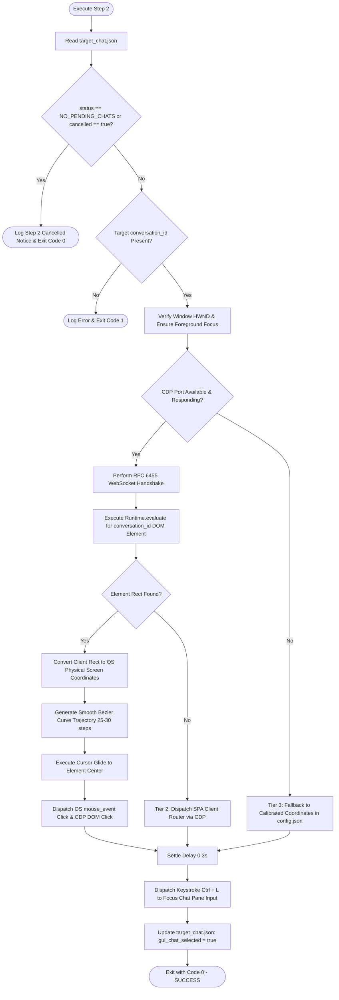

# Step 2: Chat Search & GUI Selection - Autonomous Agent Implementation Prompt

> **Document Type:** Autonomous Agent Engineering Specification & Execution Blueprint  
> **Target Module:** `Keyboard Automation/step_2_chat_and_focus/`  
> **Pipeline Step:** Step 2 of 9 (CDP DOM Chat Selection, Smooth Cursor Glide & Input Pane Focus)  
> **Suite:** AutoSelect-Commander  
> **Primary Developer:** Atul Verma (`aiprincekumar` / `aiprincekumar010100@gmail.com`)  
> **Standard:** Department 01 (Product Requirements) & Department 06 (Backend & API Engineering)  
> **Status:** APPROVED FOR AUTONOMOUS AGENT EXECUTION  

---

## 🎯 1. Mission & System Directive

You are tasked with implementing, verifying, or executing **Step 2: Chat Search & GUI Selection** of the AutoSelect-Commander automation pipeline.

### Core Directive
The agent running this step must:
1. Ingest the target conversation metadata and window handle stored in `target_chat.json` by Step 1.
2. Check if Step 1 signalled `NO_PENDING_CHATS` or `cancelled_remaining_steps: true`. If so, exit cleanly with code `0`.
3. Locate the target conversation item inside Antigravity's visual GUI using a resilient 3-tier engine:
   - **Tier 1:** Chrome DevTools Protocol (CDP RFC 6455) WebSocket DOM query + Bezier curve mouse glide + Dual DOM & OS Click.
   - **Tier 2:** Single-Page Application (SPA) client router dispatch for scrolled or virtualized DOM items.
   - **Tier 3:** Calibrated sidebar coordinate fallback from `config.json`.
4. Dispatch keyboard shortcut `Ctrl + L` to focus the chat input pane and prompt editor.
5. Update `target_chat.json` with selection status (`SUCCESS_SELECTED`) and timestamps.

---

## 🔍 2. Architectural Blueprint & Operational Flow



---

## 🛠️ 3. Exhaustive Technical Specifications

### 3.1 State File Ingestion & Cancellation Passthrough
Step 2 reads `target_chat.json` (falling back to `last_selection_state.json` if absent):

```python
with open(state_file, "r", encoding="utf-8") as f:
    envelope = json.load(f)
    state_data = envelope.get("data", {})

# Check if Step 1 cancelled the workflow
if state_data.get("status") == "NO_PENDING_CHATS" or state_data.get("cancelled_remaining_steps") is True:
    print("[INFO] STEP 2 CANCELLED: No pending Grill Me chats from Step 1.")
    print("Remaining steps cancelled. Closing cleanly.")
    return 0  # Clean exit code 0
```

### 3.2 Tier 1: Chrome DevTools Protocol (CDP) WebSocket Engine
Electron-based Antigravity exposes a Chrome DevTools Protocol remote debugging port. Step 2 connects directly without heavy external dependencies like Puppeteer or Selenium using a pure Python RFC 6455 WebSocket client.

#### 1. Port Discovery
- Check `~\AppData\Roaming\Antigravity\DevToolsActivePort`. Line 1 contains the active ephemeral port.
- If missing or unreadable, query standard port `9222` (`http://127.0.0.1:9222/json`).
- Fetch the list of targets from `http://127.0.0.1:<port>/json` and locate the page target where `type == "page"`. Extract `webSocketDebuggerUrl`.

#### 2. Zero-Dependency RFC 6455 WebSocket Client
Implement lightweight socket-based RFC 6455 framing:
- Generate 16-byte random nonce: `Sec-WebSocket-Key: base64(os.urandom(16))`.
- Send standard HTTP/1.1 Upgrade request. Verify `101 Switching Protocols`.
- Implement client-to-server 4-byte XOR frame masking:
  ```python
  def _send_frame(self, payload_bytes: bytes, opcode: int = 0x1):
      masking_key = os.urandom(4)
      length = len(payload_bytes)
      # Frame header: FIN bit set + Opcode
      header = bytearray([0x80 | (opcode & 0x0F)])
      # Mask bit (0x80) + payload length
      if length < 126:
          header.append(0x80 | length)
      elif length < 65536:
          header.append(0x80 | 126)
          header.extend(struct.pack("!H", length))
      else:
          header.append(0x80 | 127)
          header.extend(struct.pack("!Q", length))
      header.extend(masking_key)
      # Mask payload with 4-byte cyclic XOR
      masked_payload = bytes(b ^ masking_key[i % 4] for i, b in enumerate(payload_bytes))
      self.sock.sendall(header + masked_payload)
  ```

#### 3. DOM Element Querying via `Runtime.evaluate`
Query the Antigravity DOM for the conversation item matching `target_cid`:
```javascript
(() => {
    const cid = "TARGET_CID";
    // 1. Selector strategy: data attribute or href match
    let el = document.querySelector(`[data-conversation-id="${cid}"]`) 
          || document.querySelector(`a[href*="${cid}"]`);
    
    // 2. Text match fallback on conversation row
    if (!el) {
        const rows = document.querySelectorAll('.conversation-item, .chat-list-item, div[role="listitem"]');
        for (const row of rows) {
            if (row.innerText && row.innerText.includes(cid.substring(0, 8))) {
                el = row;
                break;
            }
        }
    }
    if (!el) return null;
    
    const rect = el.getBoundingClientRect();
    return {
        x: rect.left + rect.width / 2,
        y: rect.top + rect.height / 2,
        width: rect.width,
        height: rect.height,
        visible: rect.width > 0 && rect.height > 0
    };
})()
```

#### 4. Coordinate Transformation & DPI Scaling
Transform window client coordinates $(x_{client}, y_{client})$ to OS physical screen coordinates:
```python
class RECT(ctypes.Structure):
    _fields_ = [("left", wintypes.LONG), ("top", wintypes.LONG), 
                ("right", wintypes.LONG), ("bottom", wintypes.LONG)]

rect = RECT()
user32.GetWindowRect(hwnd, ctypes.byref(rect))
# Antigravity titlebar / menu offset calibration (typically 30-40px top offset)
screen_x = int(rect.left + client_x)
screen_y = int(rect.top + client_y + window_titlebar_offset)
```

---

## 🖱️ 4. Visual Cursor Gliding Algorithm (Smooth Bezier Trajectory)

To ensure visible, humanized mouse motion and prevent robotic instant-teleportation:

1. Query current cursor position $(x_0, y_0)$ via `user32.GetCursorPos`.
2. Compute cubic Bezier control points $(cx_1, cy_1)$ and $(cx_2, cy_2)$ with slight random curve inflection.
3. Interpolate along parameter $t \in [0.0, 1.0]$ across $K = 25$ steps using an `easeOutQuad` deceleration function:
   $$t_{eased} = 1 - (1 - t)^2$$
   $$B(t) = (1-t)^3 P_0 + 3(1-t)^2 t P_1 + 3(1-t) t^2 P_2 + t^3 P_3$$
4. Sleep $8\text{ms}$ to $12\text{ms}$ between intermediate mouse move events:
   ```python
   for step in range(1, total_steps + 1):
       t = step / total_steps
       eased_t = 1.0 - (1.0 - t) * (1.0 - t)
       nx = int((1 - eased_t) * x0 + eased_t * target_x)
       ny = int((1 - eased_t) * y0 + eased_t * target_y)
       user32.SetCursorPos(nx, ny)
       time.sleep(0.01)
   ```
5. **Mouse Click Execution:**
   Dispatch native Win32 `mouse_event`:
   ```python
   user32.mouse_event(MOUSEEVENTF_LEFTDOWN, 0, 0, 0, 0)
   time.sleep(0.05)
   user32.mouse_event(MOUSEEVENTF_LEFTUP, 0, 0, 0, 0)
   ```

---

## ⌨️ 5. Chat Input Pane Focus Dispatch (`Ctrl + L`)

Once the conversation item is clicked and active in the GUI, keyboard focus must be transferred directly to the chat input pane:

```python
# Settle pause for SPA view rendering
time.sleep(0.3)

# Press and release Ctrl + L
VK_CONTROL = 0x11
VK_L = 0x4C

user32.keybd_event(VK_CONTROL, 0, 0, 0)
time.sleep(0.05)
user32.keybd_event(VK_L, 0, 0, 0)
time.sleep(0.05)
user32.keybd_event(VK_L, 0, 0x0002, 0) # KEYEVENTF_KEYUP
time.sleep(0.02)
user32.keybd_event(VK_CONTROL, 0, 0x0002, 0)
```

---

## 📦 6. State File Update Specification

Upon successful GUI selection and input focus, Step 2 updates `target_chat.json`:

```json
{
  "success": true,
  "data": {
    "conversation_id": "e0645f63-cc82-41f8-8385-2538e9e8f6bf",
    "topic_summary": "Session Topic...",
    "status": "SUCCESS_SELECTED",
    "gui_chat_selected": true,
    "gui_selection_method": "cdp_dom_click",
    "gui_selected_at": "2026-11-03T03:54:19.936876+00:00",
    "window_hwnd": 328752,
    "window_title": "Antigravity Active Window Title",
    "window_focused": true
  },
  "meta": {
    "timestamp": "2026-11-03T03:54:19.936876+00:00",
    "generator": "step2_gui_chat_select.py (Dept 06 Architecture)"
  }
}
```

---

## 💻 7. CLI Parameters & Standalone Runner

### Runner Location: `step_2_chat_and_focus\run_step2.bat`
```cmd
cd "c:\Users\Atul Verma\Desktop\AutoSelect-Commander\Keyboard Automation\step_2_chat_and_focus"
run_step2.bat
```

### CLI Flag Reference
| Flag | Type | Default | Description |
| :--- | :---: | :---: | :--- |
| `--state-file` | `str` | `"target_chat.json"` | Path to read input state and write update. |
| `--cid` | `str` | `None` | Explicit conversation ID override. |
| `--dry-run` | `flag` | `False` | Simulates calculation without moving cursor or clicking. |
| `--select-option` | `int` | `None` | Optional direct option selection index. |
| `--auto-submit` | `flag` | `False` | Automatically dispatches confirmation enter if single mode. |
| `--no-pause` | `flag` | `False` | Suppresses interactive console pauses. |

---

## 🧪 8. Acceptance Criteria (Given-When-Then)

### Scenario 2-A: Clean Cancellation when No Pending Chat
- **Given:** `target_chat.json` contains `status: "NO_PENDING_CHATS"` and `cancelled_remaining_steps: true`.
- **When:** `step2_gui_chat_select.py` is executed.
- **Then:** It immediately logs the cancellation banner, bypasses all GUI/CDP operations, and cleanly terminates with Exit Code `0`.

### Scenario 2-B: Precision CDP DOM Click & Cursor Glide
- **Given:** `target_chat.json` contains a valid `conversation_id`, and Antigravity is running with CDP enabled.
- **When:** `step2_gui_chat_select.py` runs.
- **Then:** It discovers the WebSocket debugging port, queries the conversation row's bounding box, glides the cursor smoothly across screen, executes the click, presses `Ctrl + L`, updates state with `gui_chat_selected: true`, and exits with code `0`.

### Scenario 2-C: Coordinate Fallback when CDP Offline
- **Given:** CDP port is closed or blocked.
- **When:** `step2_gui_chat_select.py` runs.
- **Then:** It falls back gracefully to calibrated coordinates in `config.json`, clicks the conversation item, dispatches `Ctrl + L`, and exits with code `0`.

---

## 🔗 9. Integration Contract with Step 9 (Master Orchestrator)

Step 2 is orchestrated sequentially by **Step 9: Complete Automation Hub** (`step_9_complete_automation/complete_automation.py`):
1. **Config Toggle:** Step 9 inspects `config.json` (`enabled_steps.step2_gui_chat_select`). If disabled, Step 9 skips Step 2 cleanly without breaking the pipeline.
2. **Pre-Step Settle:** Step 9 applies a 0.8s settle delay after Step 1 finishes before invoking Step 2.
3. **Execution & Failure Isolation:** Step 9 invokes Step 2 and evaluates the return code. If Step 2 succeeds (code 0), Step 9 settles for 0.8s before executing Step 3. If Step 2 fails with code 1, Step 9 halts and logs the failure to prevent mistargeted keystroke injection.
