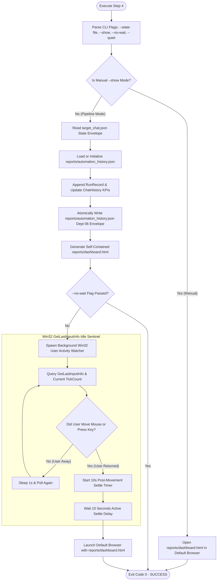

# Step 4: Reporting & Visual Dashboard - Autonomous Agent Implementation Prompt

> **Document Type:** Autonomous Agent Engineering Specification & Execution Blueprint  
> **Target Module:** `Keyboard Automation/step_4_reporting/`  
> **Hindi Name:** 'स्टेप 4: रिपोर्टिंग एवं विजुअल डैशबोर्ड'  
> **English Name:** 'Step 4: Reporting & Visual Dashboard Engine'  
> **Pipeline Step:** Step 4 of 9 (Execution Telemetry, State Persistence & User Activity Watcher)  
> **Suite:** AutoSelect-Commander  
> **Primary Developer:** Atul Verma (`aiprincekumar` / `aiprincekumar010100@gmail.com`)  
> **Standard:** Department 06 (Backend & API Engineering), Department 04 (UI/UX Design System) & Department 08 (QA)  
> **Status:** APPROVED FOR PRODUCTION & TESTING EXECUTION (13/13 Unit Tests Passed)  

---

## 🎯 1. Mission & System Directive

You are tasked with implementing, verifying, or executing **Step 4: Reporting & Visual Dashboard** ('स्टेप 4: रिपोर्टिंग एवं विजुअल डैशबोर्ड') of the AutoSelect-Commander automation pipeline.

### Core Directive
Step 4 captures and persists the complete execution telemetry of every automated questionnaire run, providing a tamper-proof historical audit trail and an interactive, modern visual dashboard.

The agent operating or maintaining this step must uphold:
1. **The Two-Way Operating Model:**
   - **Automated Pipeline Mode:**
     - Runs silently in the background when invoked by the master pipeline.
     - Persists execution state into `reports/automation_history.json` adhering to the Department 06 JSON Envelope standard.
     - Generates and synchronizes `reports/dashboard.html`.
     - **Win32 User Activity Watcher (`GetLastInputInfo`):** Monitors user physical keyboard and mouse activity. If the user is away / idle, Step 4 remains **100% silent** (does NOT launch any browser or steal focus). When the user returns and interacts with the PC, it waits for a configured settle delay (default 10 seconds post-movement) before smoothly popping open the visual dashboard.
   - **Manual Mode:**
     - Triggered directly via `run_step4.bat` or the `--show` CLI flag.
     - Immediately launches `reports/dashboard.html` in the user's default browser with zero delay.
2. **The 7 Core Telemetry Points & KPIs:**
   - Total pipeline runs completed.
   - Total questions autonomously answered.
   - Exact runtime in seconds / milliseconds.
   - Unique conversations / chats processed.
   - Chat-wise question breakdown and run history.
   - Detailed Question/Option Cards with selected option highlighted by an **Emerald Badge** (`[RECOMMENDED]`).
   - Self-contained, responsive HTML visual dashboard conforming to Department 04 design tokens (zero npm/CDN dependencies).

---

## 🔍 2. Architectural Blueprint & Operational Flow



---

## 📊 3. The 7 Core Telemetry Points & KPIs

| KPI # | Metric / Feature | JSON Schema Path | Visual Representation in `dashboard.html` |
| :---: | :--- | :--- | :--- |
| **1** | **Total Pipeline Runs** | `data.summary.total_runs` | Emerald Glassmorphism Metric Card (`Total Pipeline Runs`) |
| **2** | **Questions Answered** | `data.summary.total_questions_answered` | Blue Glassmorphism Metric Card (`Questions Answered`) |
| **3** | **Average & Last Runtime** | `data.summary.average_runtime_seconds` & `last_run.duration_seconds` | Purple Glassmorphism Metric Card (`Last Runtime / Avg`) |
| **4** | **Unique Chats Processed** | `data.summary.unique_chats_count` | Amber Glassmorphism Metric Card (`Unique Chats`) |
| **5** | **Chat-Wise Breakdown** | `data.chats[conversation_id]` | Interactive collapsible table listing all conversations, run counts, and last active timestamp |
| **6** | **Question / Options Cards** | `run.questions[].options` & `selected_option_text` | Full question text cards; selected option prominently marked with an **Emerald Badge** (`[RECOMMENDED]`) |
| **7** | **Visual HTML Dashboard** | `step_4_reporting/reports/dashboard.html` | Self-contained, responsive web UI with zero external dependencies (pure embedded CSS & SVG icons) |

---

## 📜 4. Department 06 JSON State Envelope (`automation_history.json`)

The execution ledger is persisted in `step_4_reporting/reports/automation_history.json`:

```json
{
  "success": true,
  "data": {
    "summary": {
      "total_runs": 14,
      "total_questions_answered": 28,
      "unique_chats_count": 6,
      "average_runtime_seconds": 1.42,
      "last_updated": "2026-11-04T05:25:00.000Z"
    },
    "runs": [
      {
        "run_id": "run_20261104_052500_123",
        "conversation_id": "6b52232f-0326-437c-9a22-cecab6452125",
        "timestamp": "2026-11-04T05:25:00.000Z",
        "duration_seconds": 1.25,
        "questions_count": 2,
        "status": "SUCCESS",
        "questions": [
          {
            "question_index": 1,
            "question": "Which architecture pattern should be applied for reporting?",
            "options": [
              "(Recommended) Department 06 JSON Envelope + Win32 GetLastInputInfo",
              "Monolithic file append without schema"
            ],
            "selected_option_index": 1,
            "selected_option_text": "(Recommended) Department 06 JSON Envelope + Win32 GetLastInputInfo",
            "is_recommended": true
          }
        ]
      }
    ],
    "chats": {
      "6b52232f-0326-437c-9a22-cecab6452125": {
        "conversation_id": "6b52232f-0326-437c-9a22-cecab6452125",
        "first_seen": "2026-11-03T10:00:00.000Z",
        "last_seen": "2026-11-04T05:25:00.000Z",
        "total_runs": 3,
        "total_questions_answered": 6
      }
    }
  },
  "meta": {
    "generator": "step4_reporting.py (Dept 06 & 04 Architecture)",
    "version": "1.0.0",
    "timestamp": "2026-11-04T05:25:00.000Z"
  }
}
```

---

## 🎨 5. Department 04 Visual Design Tokens (`dashboard.html`)

The generated visual dashboard strictly complies with **Department 04 (UI/UX Design System)** tokens:
- **Color Palette:**
  - Background: Deep Slate `#0f172a`
  - Card Surface: Dark Navy Glassmorphism `rgba(30, 41, 59, 0.7)` with `backdrop-filter: blur(12px)`
  - Accent Emerald: `#10b981` (Success / Recommended Selection Badge)
  - Accent Cyan: `#06b6d4` (Informational Metrics)
  - Accent Purple: `#8b5cf6` (Pipeline Timers)
  - Text Primary: `#f8fafc`
  - Text Muted: `#94a3b8`
- **Zero External Dependencies:**
  - CSS is 100% embedded in `<style>` tags.
  - Icons are inline SVG paths.
  - Zero CDN links (`fonts.googleapis.com`, `cdnjs`, etc.), ensuring full functionality on air-gapped or offline developer machines.

---

## 📁 6. File Topology & Modules

| File | Role | Type |
| :--- | :--- | :--- |
| **`step_4_reporting/__init__.py`** | Package exports: `Step4ReportingEngine`, `AutomationHistory`, `RunRecord`, `watch_for_user_input`. | **PACKAGE INIT** |
| **`step_4_reporting/step4_reporting.py`** | Core reporting engine, telemetry writer, HTML generator & Win32 idle watcher. | **PRIMARY SCRIPT** |
| **`step_4_reporting/run_step4.bat`** | 1-click manual runner to immediately view the visual HTML dashboard in default browser. | **MANUAL RUNNER** |
| **`step_4_reporting/reports/automation_history.json`** | Persistent JSON execution history adhering to Department 06 envelope. | **PERSISTENT STATE** |
| **`step_4_reporting/reports/dashboard.html`** | Self-contained, responsive visual dashboard adhering to Department 04 tokens. | **HTML DASHBOARD** |
| **`step_4_reporting/test_step4_reporting.py`** | Automated unit test suite verifying reporting logic, JSON persistence, and modes (13/13 passed). | **UNIT TEST** |

---

## 🛠️ 7. CLI Arguments Reference

```cmd
python step4_reporting.py [OPTIONS]
```

| Flag | Type | Default | Description |
| :--- | :---: | :---: | :--- |
| `--show` | flag | `False` | Immediately opens the visual dashboard in default browser (Manual Mode). |
| `--state-file` | path | `target_chat.json` | Path to the runtime state envelope generated by Steps 1-3. |
| `--history-file`| path | `reports/automation_history.json` | Path to persistent execution history file. |
| `--dashboard-file`| path | `reports/dashboard.html` | Path to generated HTML visual dashboard. |
| `--user-activity-delay` | float | `10.0` | Settle delay in seconds after user returns before opening browser. |
| `--no-wait` | flag | `False` | Suppresses user activity watcher in pipeline mode (silent write only). |
| `--quiet` | flag | `False` | Suppresses console progress logs. |

---

## 🔗 8. Integration Contract with Step 9 (Master Orchestrator)

Step 4 is orchestrated by **Step 9: Complete Automation Hub** (`step_9_complete_automation/complete_automation.py`):
1. **Pipeline Invocation:** After Step 3 completes successfully, Step 9 pauses for 0.8s and invokes Step 4.
2. **Config Toggle:** If `config.json` (`enabled_steps.step4_reporting`) is `false`, Step 9 skips Step 4 cleanly.
3. **Background Watching:** In automated pipeline runs, Step 4 is launched with `--user-activity-delay 10.0`, ensuring the dashboard never interrupts an unattended machine.
