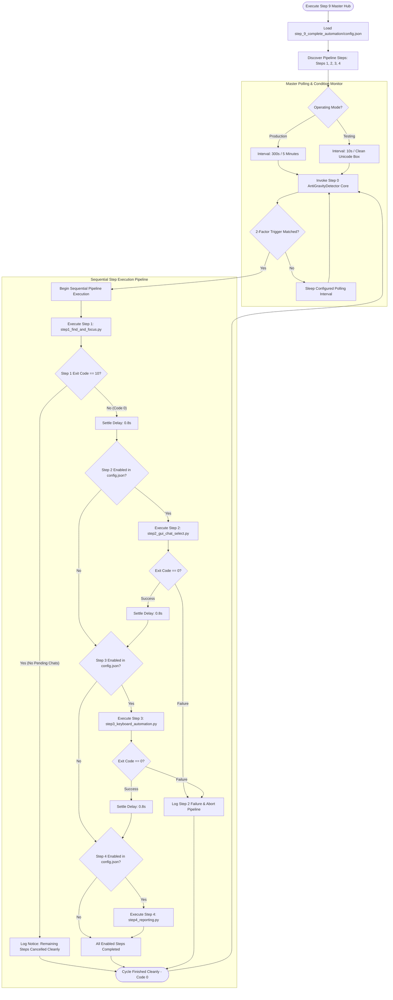

# Step 9: Complete Automation Hub - Autonomous Agent Implementation Prompt

> **Document Type:** Autonomous Agent Engineering Specification & Execution Blueprint  
> **Target Module:** `Keyboard Automation/step_9_complete_automation/`  
> **Hindi Name:** 'स्टेप 9: कम्प्लीट ऑटोमेशन हब'  
> **English Name:** 'Step 9: Complete Automation Hub (Master Orchestrator)'  
> **Pipeline Step:** Step 9 (Master Pipeline Controller, User Interaction Hub & Step Orchestrator)  
> **Suite:** AutoSelect-Commander  
> **Primary Developer:** Atul Verma (`aiprincekumar` / `aiprincekumar010100@gmail.com`)  
> **Standard:** Department 06 (Backend & API Engineering), Department 02 (Solution Architecture) & Department 01  
> **Status:** APPROVED FOR PRODUCTION & TESTING EXECUTION (12/12 Unit Tests Passed)  

---

## 🎯 1. Mission & System Directive

You are tasked with implementing, verifying, or executing **Step 9: Complete Automation Hub** ('स्टेप 9: कम्प्लीट ऑटोमेशन हब') of the AutoSelect-Commander automation suite.

### Core Directives
1. **Single Point of User Interaction:**
   - The `step_9_complete_automation/` directory serves as the **exclusive entrypoint** for the end user.
   - The user never needs to manually navigate to or execute individual step folders (Step 0, Step 1, Step 2, Step 3, Step 4).
   - All timing configurations, active step toggles, and runners are managed here.
2. **Alphabetical Directory Anchoring (Step 9):**
   - The directory is explicitly named `step_9_complete_automation` so that in file explorers, terminals, and IDE trees, it remains anchored at the very end of the step list, eliminating visual disorder and confusion.
3. **Master Pipeline Scheduling & Orchestration:**
   - Evaluates condition detection via the Step 0 core (`AntiGravityDetector`).
   - When the two-factor trigger condition is met (Antigravity Open + Pending Grill-Me Chat), Step 9 orchestrates the sequential step pipeline:
     $$\text{Step 0 (Trigger)} \longrightarrow \text{Step 1} \xrightarrow{\text{Settle}} \text{Step 2} \xrightarrow{\text{Settle}} \text{Step 3} \xrightarrow{\text{Settle}} \text{Step 4}$$
4. **Graceful Exit Code 10 Cancellation Handling:**
   - If Step 1 exits with code `10` (`NO_PENDING_CHATS`), Step 9 immediately aborts remaining steps cleanly without raising an exception, recording a completed cycle with 0 errors.
5. **Dynamic Future Step Discovery:**
   - Automatically detects and chains future modular steps (`step_5_*` through `step_8_*`), while strictly excluding itself (`step_9_complete_automation`) to prevent recursive execution loops.

---

## 🔍 2. Architectural Blueprint & Operational Flow



---

## ⚙️ 3. Master Configuration Schema (`config.json`)

All runtime options, cadence intervals, and step toggles are user-editable in `step_9_complete_automation/config.json`:

```json
{
  "_comment": "Step 9: Complete Automation Configuration - AutoSelect-Commander Master Configuration",
  "mode": "production",
  "timing": {
    "step0_poll_interval_prod_seconds": 300.0,
    "step0_poll_interval_test_seconds": 10.0,
    "settle_delay_between_steps_seconds": 0.8,
    "step4_user_activity_delay_seconds": 10.0
  },
  "enabled_steps": {
    "step1_find_and_focus": true,
    "step2_gui_chat_select": true,
    "step3_keyboard_automation": true,
    "step4_reporting": true
  },
  "antigravity": {
    "require_grill_me": true,
    "active_hours": 12.0
  },
  "logging": {
    "log_file": "complete_automation.log",
    "verbose": true
  }
}
```

### Parameter Reference
- `mode`: `"production"` (silent 300s background loop) or `"test"` (10s timer live dashboard).
- `timing.step0_poll_interval_prod_seconds`: Background sleep duration between status checks.
- `timing.settle_delay_between_steps_seconds`: Safety pause between sequential child step executions (default `0.8` seconds).
- `timing.step4_user_activity_delay_seconds`: Settle delay used by Step 4's user activity monitor before opening the visual dashboard.
- `enabled_steps`: Independent boolean toggles allowing any single step to be bypassed without editing source code.

---

## 📁 4. File Topology & Modules

| File | Role | Type |
| :--- | :--- | :--- |
| **`step_9_complete_automation/__init__.py`** | Package initialization and module exports. | **PACKAGE INIT** |
| **`step_9_complete_automation/config.json`** | Unified user-editable configuration controlling timers and step toggles. | **CONFIG FILE** |
| **`step_9_complete_automation/complete_automation.py`** | Master pipeline controller, scheduler, step dispatcher & signal handler. | **MASTER SCRIPT** |
| **`step_9_complete_automation/run_complete_automation_prod.bat`** | 1-click launcher for 5-minute background autonomous production runner. | **PROD RUNNER** |
| **`step_9_complete_automation/run_complete_automation_test.bat`** | 1-click launcher for 10-second timer testing runner with clean live dashboard. | **TEST RUNNER** |
| **`step_9_complete_automation/open_dashboard.bat`** | 1-click launcher to open the visual HTML dashboard directly in browser. | **DASHBOARD RUNNER** |
| **`step_9_complete_automation/test_complete_automation.py`** | Automated unit test suite verifying configuration, step discovery, and execution flows (12/12 passed). | **UNIT TEST** |

---

## 🛠️ 5. CLI Arguments Reference

```cmd
python complete_automation.py [OPTIONS]
```

| Flag | Type | Default | Description |
| :--- | :---: | :---: | :--- |
| `--config`, `-c` | path | `config.json` | Path to custom configuration JSON file. |
| `--mode`, `-m` | string | `None` | Override execution mode (`"production"` or `"test"`). |
| `--once` | flag | `False` | Execute a single evaluation cycle and terminate. |
| `--headless` | flag | `False` | Run completely headlessly without interactive console pauses. |
| `--no-pause` | flag | `False` | Suppresses console pause prompts upon script termination. |
| `--verbose`, `-v` | flag | `False` | Enable detailed debug logging in console. |

---

## 🧪 6. Acceptance Criteria (Given-When-Then)

### Scenario 9-A: Production Background Loop
- **Given:** `config.json` is configured with `mode: "production"`.
- **When:** `run_complete_automation_prod.bat` is launched.
- **Then:** It polls every 300 seconds. When Antigravity has a pending question, it executes Step 1 $\to$ Step 2 $\to$ Step 3 $\to$ Step 4 sequentially with 0.8s settle delays.

### Scenario 9-B: Step 1 Graceful Exit Code 10 Cancellation
- **Given:** Step 1 discovers zero active unanswered questionnaires and exits with code `10`.
- **When:** Step 9 intercepts the return code.
- **Then:** It cleanly cancels Steps 2, 3, and 4, logs the cancellation notice, and returns to the polling loop without failing.

### Scenario 9-C: Step Disabling via `config.json`
- **Given:** `config.json` sets `"step2_gui_chat_select": false`.
- **When:** Complete automation triggers a pipeline run.
- **Then:** Step 9 executes Step 1, skips Step 2, executes Step 3, and executes Step 4. All unit tests pass.
