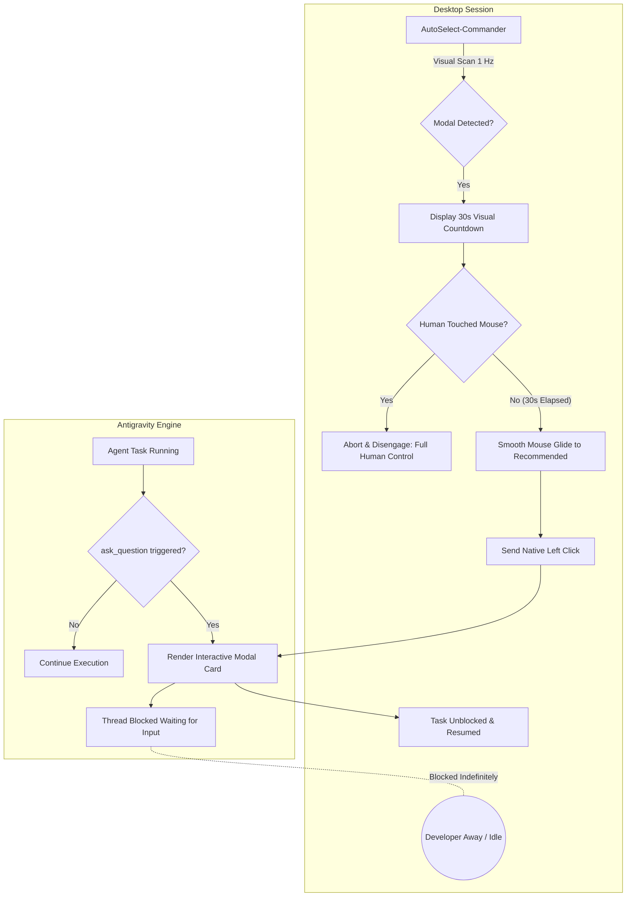
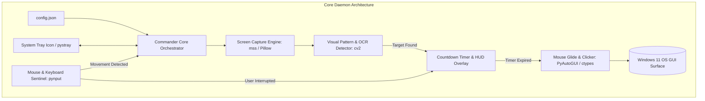
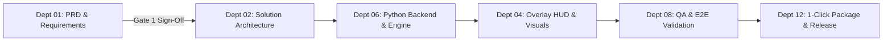

# AutoSelect-Commander - Product Requirements Document (PRD)

> **Document Type:** Production-Grade Product Requirements Document (PRD)  
> **Project Name:** AutoSelect-Commander (Visual Mouse Automation & Auto-Selector for Antigravity)  
> **Project Path:** `C:\Users\Atul Verma\Desktop\AutoSelect-Commander\`  
> **Department Owner:** Dept 01: Product Requirements & Management  
> **Target Audience:** Engineering Leads, Solution Architects (Dept 02), QA Engineers (Dept 08)  
> **Status:** Approved / Ready for Architecture Specification (Phase 01 Complete)  
> **Date:** October 31, 2026  
> **Author:** Product Scope Architect (Subagent Archetype 5.1)  

---

## 1. Executive Summary & Vision

### 1.1 Executive Summary
**AutoSelect-Commander** is a lightweight, non-invasive, visual client-side automation daemon built in Python for Windows 11. It eliminates the execution blockage encountered when Antigravity (and AI coding agent runtimes) invokes interactive user confirmation prompts (specifically the `ask_question` dialog). Running strictly within the user's active interactive desktop session (Session 1), AutoSelect-Commander continuously monitors the display using high-efficiency computer vision and UI Automation hooks. 

Upon detecting an Antigravity decision card, it displays an unobtrusive non-stealing transparent countdown timer (default 30 seconds). Unless the developer manually touches or shakes the mouse to take control, AutoSelect-Commander smoothly glides the mouse cursor to the `(Recommended)` choice, verifies button focus, and clicks it automatically. This guarantees truly autonomous, uninterrupted continuous development workflows (such as overnight test runs, rule refactorings, and multi-file migrations) while retaining 100% human-in-the-loop override authority.

### 1.2 Vision Statement
> *"Transform Antigravity pair programming into an unblockable, autonomous engineering engine by bridging the gap between isolated agent background processes and the interactive desktop surface through safe, visually aware, human-overrideable automation."*

### 1.3 Key Metrics & Success Criteria (KPIs)
- **Zero-Block Autonomy:** 100% resolution rate of pending `ask_question` modals during unattended overnight runs.
- **Fail-Safe Integrity:** 0% false clicks when human developers intervene (mouse movement detection within < 50ms).
- **Resource Footprint:** Idle CPU utilization < 1.0%, Peak memory utilization < 65 MB.
- **Detection Precision:** > 99.5% accuracy in distinguishing Antigravity interactive prompt cards from ambient IDE code or chat transcripts across standard resolutions (1080p, 2K, 4K) and Windows Display Scaling levels (100%, 125%, 150%).

---

## 2. Problem Statement & Root Cause Architecture Analysis

### 2.1 The Problem
When Antigravity processes run automated sequences (e.g., test suites, subagent delegations, git push gates, or refactoring loops), they frequently encounter interactive safety gates powered by the `ask_question` tool. In typical workflows, Antigravity renders a modal asking for confirmation with multiple options, where the first option is marked `(Recommended)`.

While this safeguards against unintended operations, it halts the entire agent execution thread indefinitely until a human physically clicks an option. If the developer steps away or launches an overnight task, the entire agent fleet goes idle at minute 3, stalling hours of productive development time.



### 2.2 Root Cause Architecture Analysis

#### 2.2.1 Windows Session 0 vs. Session 1 Isolation
Modern Windows operating systems strictly isolate background services and non-interactive tasks (running in Session 0) from interactive user desktops (Session 1). Terminal commands spawned by AI processes cannot inject Windows mouse input messages (`WM_LBUTTONDOWN`, `SendInput`) directly into interactive windows without elevated desktop session permissions and desktop handle access (`GetThreadDesktop`).

#### 2.2.2 Electron Sandbox & DOM Shadow Boundaries
Antigravity operates within an Electron-based shell. Standard web automation tools cannot hook into the internal renderer DOM from outside without remote debugging flags (`--remote-debugging-port`), which are disabled in production builds for security. Furthermore, UI Automation (UIA) accessibility trees inside hardware-accelerated Chromium renderers frequently drop accessibility nodes for custom styled dialog buttons unless accessibility flags are explicitly activated.

#### 2.2.3 The Visual Solution
The only robust, universal, non-intrusive method to interact with Antigravity modals without modifying its internal binaries or compromising sandbox security is **Client-Side Visual Computer Vision (CV) combined with native Windows OS mouse driver emulation (`PyAutoGUI` / `ctypes SendInput`)** running directly within the user's interactive desktop session.

---

## 3. Target User Persona & Operational Scenarios

### 3.1 Primary Persona: The Autonomous AI Pair Programmer ("The Night Builder")
- **Role:** Senior Full-Stack Engineer / AI Systems Architect utilizing Antigravity for continuous agentic coding.
- **Environment:** Windows 11 Desktop / Workstation running multi-screen setups (1080p to 4K).
- **Core Frustration:** Initiating a 4-hour migration or comprehensive unit-testing sprint before going to bed or stepping into a meeting, only to return and discover the agent paused 5 minutes after initiation due to a confirmation popup asking `(Recommended) Proceed with migration`.
- **Key Requirement:** A reliable "safety valve" that grants 30 seconds for manual intervention, but automatically selects the recommended path if no objection is raised.

### 3.2 Operational Scenarios

| Scenario ID | Scenario Description | Expected System Behavior |
| :--- | :--- | :--- |
| **SC-01: Attended Mode** | Developer is active at the desk, reading the prompt. | AutoSelect-Commander displays the 30s countdown. Developer moves mouse; timer immediately aborts and suppresses auto-click. |
| **SC-02: Unattended Mode** | Developer is away (coffee break or sleeping). | Prompt appears; countdown counts down from 30 to 0; cursor smoothly moves to `(Recommended)` and clicks; agent execution unblocks. |
| **SC-03: Quick Override** | Developer wants to choose Option 2 instead of Option 1. | Developer moves mouse directly to Option 2. AutoSelect-Commander detects movement > 10 pixels and shuts down countdown instantly. |
| **SC-04: Transient Disappearance**| Antigravity cancels prompt or agent finishes via timeout. | AutoSelect-Commander detects card disappearance during countdown; instantly resets state without clicking. |

---

## 4. Scope Boundaries

### 4.1 In-Scope
- **Visual Recognition:** Template matching and localized OCR for Antigravity question modals, choice cards, and the `(Recommended)` anchor tag.
- **Non-Intrusive Countdown Timer:** Semi-transparent, click-through on-screen HUD displaying remaining seconds above or adjacent to the target modal.
- **Human-Like Cursor Trajectory:** Bezier curve or smooth ease-out cursor translation avoiding abrupt coordinate jumps.
- **Interruptible State Engine:** Immediate cancellation upon physical mouse displacement (`delta > threshold`) or keyboard activity.
- **Configurability:** External `config.json` for countdown duration (default 30s, range 5s–120s), polling frequency (1 Hz–5 Hz), confidence thresholds, and hotkeys.
- **1-Click Packaging:** Standalone `launch_commander.bat` and PowerShell launcher with auto virtual environment (venv) bootstrap and dependency installation.
- **Tray Daemon:** Windows System Tray icon indicating status (Idle, Scanning, Counting Down, Interrupted).

### 4.2 Out-of-Scope (Deferred to Future Iterations)
- Direct modification or reverse-engineering of Antigravity internal binaries, ASAR archives, or Electron code.
- Remote telemetry streaming to cloud dashboards (must run 100% offline, local only).
- Support for operating systems other than Microsoft Windows 10/11 (macOS / Linux deferred to v2.0).
- Automatic text typing or answering arbitrary open-text form inputs (restricted strictly to multiple-choice recommendation selection).

---

## 5. Functional Requirements (FR)

### FR-1: Visual Screen Detection & Card Localization
- **FR-1.1:** The system shall periodically (default: every 1.0 second) capture the primary screen or active Antigravity window viewport using memory-efficient frame grabbing (`Pillow.ImageGrab` / `d3dshot` / `mss`).
- **FR-1.2:** The system shall analyze the frame to detect Antigravity's modal card container by identifying signature visual markers:
  - Header styling / theme palette (`#1E1E2E`, `#2D2D3F`, or light equivalent).
  - High-confidence text anchor matching for `(Recommended)` option prefix.
  - Multi-scale template matching via OpenCV (`cv2.matchTemplate` with `TM_CCOEFF_NORMED`) or ultra-fast localized Tesseract OCR / EasyOCR.
- **FR-1.3:** The system shall calculate the bounding box coordinates `(x, y, w, h)` of the `(Recommended)` clickable target item and determine its geometric center `(center_x, center_y)`.
- **FR-1.4:** The system shall support high-DPI awareness (`SetProcessDpiAwarenessContext`) to ensure screen coordinate mappings match physical device pixels accurately.

### FR-2: 30-Second Non-Stealing Visual Countdown Timer
- **FR-2.1:** Upon state transition to `DETECTED`, the system shall initialize a configurable countdown timer (default: 30 seconds).
- **FR-2.2:** The system shall render a sleek, transparent, non-focused floating HUD overlay (using PyQt6 or Tkinter with `WS_EX_LAYERED | WS_EX_TRANSPARENT | WS_EX_NOACTIVATE` Win32 window attributes) displaying:
  - Remaining time in seconds: `"Auto-selecting (Recommended) in: 28s"`.
  - Hint text: `"Move mouse or press ESC to cancel"`.
  - Visual circular or linear progress bar smoothly decrementing.
- **FR-2.3:** The countdown HUD must never steal window focus from Antigravity or any other active application.

### FR-3: Smooth Human-Like Mouse Navigation & Verification Click
- **FR-3.1:** When countdown reaches 0 without interruption, the system shall fetch the current cursor position `(start_x, start_y)`.
- **FR-3.2:** The system shall generate a smooth, natural cursor path using an easing trajectory (e.g., cubic ease-in-out or randomized Bezier curve) spanning a duration of 0.8s to 1.5s to reach `(target_x, target_y)`.
- **FR-3.3:** The system shall verify that the target coordinate still contains the expected button visual attributes before issuing the click.
- **FR-3.4:** The system shall issue a native mouse event sequence (`mouse_event` or `SendInput`: down -> 100ms dwell -> up).
- **FR-3.5:** Following the click, the system shall wait 500ms, verify the modal has dismissed, and transition back to `IDLE_SCANNING`.

### FR-4: User Interruption & Fail-Safe Protocol
- **FR-4.1:** The system shall continuously track the physical mouse coordinates during the countdown state at 50 Hz.
- **FR-4.2:** If the mouse moves more than 15 physical pixels from its stationary position due to human input, the system shall immediately:
  - Abort the countdown.
  - Destroy the visual HUD overlay.
  - Log an `INTERRUPTED_BY_USER` event.
  - Enter a temporary cooldown suppression state (e.g., 60 seconds) or wait until the modal is closed before re-arming.
- **FR-4.3:** The system shall listen for global hotkeys (`ESC` or `Ctrl+Alt+S`) to toggle pause/unpause or instantly kill active automated movements.
- **FR-4.4:** PyAutoGUI fail-safe mode (`pyautogui.FAILSAFE = True`) must remain strictly enforced, ensuring moving the mouse cursor to any monitor corner instantly raises an emergency abort.

### FR-5: 1-Click Windows Launcher & Configuration Engine
- **FR-5.1:** The project must include a self-contained root launcher `launch_commander.bat` that:
  - Detects if Python 3.10+ is installed on the host.
  - Automatically provisions a local `.venv` if not present.
  - Silently installs all requirements (`requirements.txt`).
  - Launches `commander.py` in the background with a system tray icon.
- **FR-5.2:** All operational parameters must be loaded from a human-editable `config.json`:
  ```json
  {
    "countdown_seconds": 30,
    "scan_interval_ms": 1000,
    "mouse_interruption_threshold_px": 15,
    "mouse_glide_duration_s": 1.2,
    "cooldown_after_dismissal_s": 5,
    "target_keyword": "(Recommended)",
    "failsafe_corner_enabled": true,
    "sound_notification": true
  }
  ```
- **FR-5.3:** System Tray integration providing:
  - Icon state indicator (Green = Active/Watching, Orange = Counting Down, Blue = Paused).
  - Context menu: "Pause Automation", "Force Auto-Click Now", "Settings", "Exit".

---

## 6. Non-Functional Requirements (NFR)

### 6.1 Performance & Resource Efficiency
- **Idle CPU Load:** < 1.0% on a standard Intel Core i5 / AMD Ryzen 5 processor while in `SCANNING` mode.
- **Screen Grab Performance:** Screen capture and OpenCV template evaluation cycle must complete within < 45ms per frame.
- **Peak RAM Footprint:** Resident Set Size (RSS) memory consumption must not exceed 65 MB.
- **Zero Leak Standard:** Continuous 72-hour execution without memory growth or handle leaks (monitored via garbage collection and explicit GDI object disposal).

### 6.2 Display & Resolution Adaptability
- **Resolution Independence:** Flawless detection across 1920x1080 (FHD), 2560x1440 (2K QHD), and 3840x2160 (4K UHD).
- **Windows Display Scale Invariance:** Complete support for 100%, 125%, 150%, and 175% OS DPI scaling without coordinate drift.
- **Multi-Monitor Awareness:** Correctly bounds mouse movements and screen captures to the monitor displaying the Antigravity application window.

### 6.3 Reliability & Process Hygiene
- **Zero-Hang Guarantee (Universal Rule 26 Compliance):** Clean termination of all threads, listeners, and HUD windows on exit. No orphan background Python processes left running in Windows Task Manager.
- **Crash Recovery:** Unhandled exceptions in the image processing loop must log to `logs/commander.log` and automatically restart the scanning loop with exponential backoff (1s, 2s, 4s) without crashing the daemon.

---

## 7. Technical Architecture & Stack Specification

### 7.1 Architecture Decomposition



### 7.2 Technology Stack

| Layer | Component | Selected Technology | Justification |
| :--- | :--- | :--- | :--- |
| **Runtime** | Core Runtime | **Python 3.10+ (x64)** | High ecosystem support, rich GUI/CV automation libraries, zero compile overhead. |
| **Capture** | Screen Grabbing | **`mss` & `Pillow`** | Ultra-low latency (< 15ms per frame capture), multi-monitor virtual screen support. |
| **Vision** | Visual Detection | **OpenCV (`opencv-python-headless`) + Local Template/OCR** | Optimized C++ computer vision primitives for pattern matching without heavy GUI overhead. |
| **Input / Drive**| Mouse & Click Emulation | **`PyAutoGUI` & `ctypes` (`SendInput`)** | Native Windows OS input dispatch; hardware-level cursor positioning and built-in fail-safes. |
| **Sentinel** | Input Activity Monitor | **`pynput`** | Low-overhead global hook to track user mouse delta and keyboard hotkeys without polling. |
| **UI HUD** | Overlay Display | **PyQt6 (Frameless, Transparent, Click-Through)** | Hardware-accelerated smooth alpha blending and clean typography for countdown graphics. |
| **Daemon Tray** | System Tray Management | **`pystray`** | Minimalist system tray daemon with context menus and reactive state icons. |

---

## 8. Edge Cases & Safety Protocols

### 8.1 Safety Protocols
1. **PyAutoGUI Hardware FAILSAFE:** If cursor hits `(0, 0)` or any monitor boundary corner during mouse motion, an immediate `FailSafeException` is thrown, instantly halting all input injection.
2. **User Hand-on-Mouse Priority:** Human motor input always overrides software automation. Any mouse movement exceeding 15px aborts the countdown immediately.
3. **Modal Loss Guard:** If the user presses `Ctrl+W`, switches tasks, or closes Antigravity while countdown is at 2 seconds, the detector verifies modal existence at `t=0` before executing any click. If missing, the click is cancelled.
4. **Click-Through HUD:** The timer overlay window must have the `WS_EX_TRANSPARENT` Win32 extended window style applied, ensuring that even if the user clicks directly on the timer graphic, the click passes straight through to the underlying application.

### 8.2 Edge Cases Matrix

| Edge Case ID | Condition | System Mitigation |
| :--- | :--- | :--- |
| **EC-01** | Multiple monitors with Antigravity on secondary screen. | Enumerate all desktop virtual screens (`mss.monitors`); locate Antigravity window handle via `win32gui` before capturing. |
| **EC-02** | Antigravity theme toggled between Dark and Light mode. | Dual-template matching (both dark-mode `#1E1E2E` and light-mode `#FFFFFF` visual card templates stored in `assets/templates/`). |
| **EC-03** | Modal has multiple options, but none contain `(Recommended)`. | If no `(Recommended)` tag is detected, the modal is treated as high-risk ambiguous. Countdown does NOT start; waits for human manual selection. |
| **EC-04** | User is actively typing code in another window when modal appears. | Timer HUD displays non-intrusively in background; does NOT steal active window focus; typing continues uninterrupted. |
| **EC-05** | Network disconnection or system sleep during countdown. | System sleep event (`WM_POWERBROADCAST`) catches suspend state, resets countdown, and arms upon wake. |

---

## 9. Acceptance Criteria & Verification Matrix

Every requirement is mapped to rigorous Given-When-Then contracts adhering to Dept 01 Gate 1-B.

### Scenario AC-01: Autonomous Unattended Recommendation Auto-Selection
- **Given:** Antigravity is running in an unattended session and triggers an `ask_question` dialog containing `(Recommended)`.
- **When:** 30 seconds elapse without any physical mouse movement or keypress.
- **Then:** The mouse cursor smoothly moves from its starting coordinates to the center of the `(Recommended)` button within 1.2 seconds, clicks the option, dismisses the modal, and Antigravity resumes execution.

### Scenario AC-02: Human Developer Movement Cancellation (Attended Mode)
- **Given:** An `ask_question` dialog is detected, and the HUD displays `"Auto-selecting in 25s"`.
- **When:** The developer physically moves the mouse by 20 pixels or presses the `ESC` key.
- **Then:** The HUD overlay vanishes instantly (< 50ms), the countdown cancels, no click is performed, and the system logs `USER_ABORT`.

### Scenario AC-03: Modal Closure Prior to Timeout
- **Given:** The countdown timer is active at `t = 12s`.
- **When:** The modal dialog is dismissed externally (e.g., agent process terminated or user closed window via keyboard).
- **Then:** The visual detector spots the disappearance on the next cycle (within 1s), resets the countdown timer to idle, and prevents any deferred mouse movement.

### Scenario AC-04: Negative Test - Ambiguous Question Without Recommendation
- **Given:** Antigravity displays an `ask_question` prompt where all options are neutral (no `(Recommended)` option prefix present).
- **When:** The visual detector scans the prompt card.
- **Then:** The system refuses to arm the countdown, logs `NO_RECOMMENDED_ANCHOR_FOUND`, and leaves the screen untouched for manual human decision.

### Scenario AC-05: 1-Click Bootstrap on Fresh Windows Machine
- **Given:** A Windows 11 machine with Python 3.10+ installed but no local packages.
- **When:** The user double-clicks `launch_commander.bat`.
- **Then:** The script automatically initializes `.venv`, installs all packages from `requirements.txt`, spawns the system tray icon, and begins scanning within < 15 seconds.

---

## 10. Implementation Roadmap & Department Handoff



- **Phase 01 (This Document):** Product Requirements Document complete and approved.
- **Phase 02 Handoff:** Transfer to **Dept 02: Solution Architecture** to produce the High-Level/Low-Level Design (`ARCHITECTURE.md`) specifying component interfaces, OpenCV template thresholds, and Win32 hook architecture.
- **Phase 03 Implementation:** Core engine development, HUD overlay, and 1-click launcher scripts.
