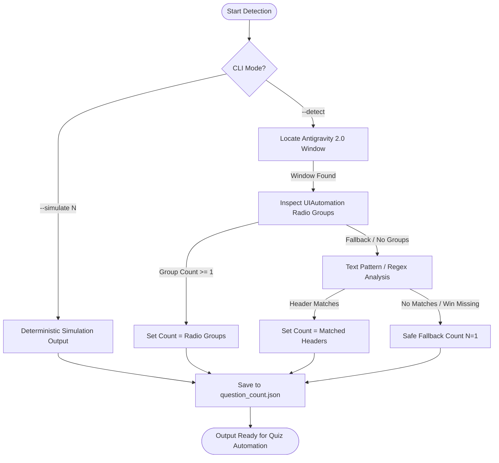

# Question Detection Subsystem

> **Module:** `Question Detection/`  
> **Target:** Antigravity 2.0 Interactive Prompt / Quiz Mode  
> **Author:** Atul Verma (`aiprincekumar` / `aiprincekumar010100@gmail.com`)  
> **Standard:** UTF-8 Encoding  

---

## 🎯 1. Overview & Purpose (अवलोकन और उद्देश्य)

In Google Antigravity 2.0 (e.g. `ask_question` tool / Grill-Me mode), questions are frequently presented in two formats:
1. **Single Question:** A card with 1 question and multiple choice options.
2. **Multi-Question Quiz (Batch):** A card containing **$N$ distinct questions** (e.g., Q1, Q2, ..., QN), each having its own set of radio buttons, followed by a single submission button.

### ⚠️ Critical Distinction: Questions vs. Options
- **Question Count ($N$):** The total number of distinct prompts being asked (e.g., 2 questions).
- **Option Count ($M$):** The number of choices available for a given question (e.g., Q1 may have 3 options, Q2 may have 4 options).
- **This module strictly detects the QUESTION COUNT ($N$)**, allowing downstream keyboard automation engines to iterate through each question cleanly before pressing Enter on the final question.

---

## 🔍 2. Detection Architecture & Precedence



1. **Simulation Mode (`--simulate N`):** Directly generates deterministic question metadata for testing and chained workflows without requiring an active UI.
2. **UIAutomation Inspection (`--detect`):** Enumerate child controls of the Antigravity window to identify distinct `ControlType.Group` elements containing `RadioButtonControl` elements.
3. **Text Pattern Analysis:** Evaluates extracted text for sequential question markers (`"Question 1 of N"`, `"Q1"`, `"Q2"`).
4. **Resilient Fallback:** If the Antigravity window is minimized, hidden, or not presenting an interactive card, it safely falls back to $N=1$.

---

## 📄 3. JSON Output Contract (`question_count.json`)

The module outputs a structured JSON file consumed by `Quiz Automation`:

```json
{
  "status": "success",
  "question_count": 3,
  "mode": "simulated",
  "target_window": "Simulated",
  "detected_at": "2026-11-02T03:00:00.000000+00:00",
  "confidence": 1.0,
  "details": {
    "method": "simulation",
    "reason": "CLI Simulation Override",
    "questions": [
      {
        "index": 1,
        "title": "Question 1",
        "simulated": true
      },
      {
        "index": 2,
        "title": "Question 2",
        "simulated": true
      },
      {
        "index": 3,
        "title": "Question 3",
        "simulated": true
      }
    ]
  }
}
```

---

## 🚀 4. Usage & Execution

### 1-Click Windows Batch Launcher
Double-click or run:
```cmd
run_detection.bat
```
Displays an interactive menu allowing you to:
- Auto-Detect from the live Antigravity window.
- Simulate 1, 2, 3, or custom question count.

### Command Line Interface (Python)
```bash
# Auto-detect from live screen
python detect_questions.py --detect

# Simulate 2 questions
python detect_questions.py --simulate 2

# Output only raw count (useful for shell scripting)
python detect_questions.py --simulate 3 --format count

# Custom output destination
python detect_questions.py --detect -o custom_output.json
```

---

## 🔗 5. Integration with Quiz Automation

Once `question_count.json` is generated, it is automatically read by `Quiz Automation/quiz_automation.py` to drive the multi-question shortcut loop:
1. `Question Detection` outputs $N$.
2. `Quiz Automation` executes $N$ iterations of `Ctrl + L` $\rightarrow$ `Shift + Tab` $\rightarrow$ `1`.
3. Enter is suppressed on questions $1 \dots N-1$, and pressed strictly on question $N$.
